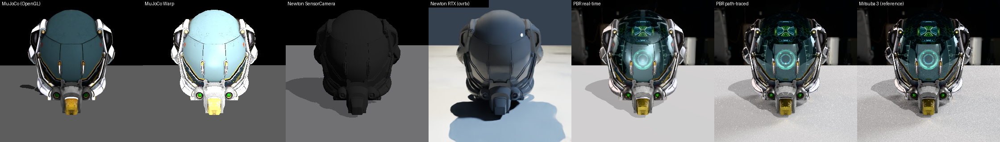

# Raywarp

A batched, physically based renderer written in [NVIDIA Warp](https://github.com/NVIDIA/warp)
(`import raywarp as rw`) for robotics training. It renders thousands of worlds x cameras per
launch with one megakernel per settings tier, prebuilt and downloaded on first use (scene data is
run-time data: a new scene compiles nothing). A format-neutral core
(`raywarp.core`, which imports only Warp and NumPy) is fed by adapters:
[MuJoCo Warp](https://github.com/google-deepmind/mujoco_warp) (`rw.integrations.mujoco`, arrays aliased
with no copy), USD (`rw.formats.usd`, host scene) and [Newton](https://github.com/newton-physics/newton)
(`rw.integrations.newton`: scenes bound to Newton bodies, a drop-in camera sensor), plus glTF (`rw.formats.gltf`) and
[mjlab](https://github.com/mujocolab/mjlab) camera sensors (`raywarp.integrations.mjlab`).

- Real-time ray tracing: primary rays, ray-traced (soft) shadows, Filament's BRDF with
  multiscatter energy compensation, LTC area lights, split-sum image-based lighting from HDR
  environment maps, normal / ORM / emissive / opacity maps with ray-cone mip selection and
  anisotropic filtering, mirror and glossy reflections, translucent layers, probe GI, fog, a
  light visibility grid and light / shadow budgets for many-light scenes.
  The default and every per-frame configuration are deterministic and noise-free.
- One material model: every source (MJCF, UsdPreviewSurface, MDL, MaterialX OpenPBR / Standard
  Surface / glTF PBR, Newton) becomes an [OpenPBR Surface](docs/scenes.md#the-material-openpbr-surface)
  (`rw.Material`), turned into device values once, at upload; what the core does not render is
  carried and reported.
- Depth (planar / radial), instance or semantic segmentation, albedo, normals, motion vectors,
  channels-first training layouts; depth and segmentation match MuJoCo Warp's renderer.
- The default, `rw.FAST` and the recipes run on prebuilt kernels: switching between them, or
  changing any single setting, compiles nothing. Material, light, environment, exposure, fog,
  camera and visibility parameters vary per world (domain randomisation) without recompiling.
  Static scenery is stored and traced once for every world.
- NVIDIA GPUs first (CUDA, OptiX RT cores, CUDA graphs with the simulator step); the CPU device
  works everywhere.

**Documentation**: the [user guide](docs/README.md) ([install](docs/install.md), [quickstart](docs/quickstart.md),
[scenes](docs/scenes.md), [settings](docs/settings.md),
[performance](docs/performance.md), [robotics recipes](docs/robotics.md), [recording video](docs/recording.md),
[command line](docs/cli.md), [benchmark](docs/benchmark.md), [FAQ](docs/faq.md)), runnable [examples](examples/)
and the [developer guide](docs/DEVELOPMENT.md) (architecture, standards, testing, adapters).
Every Python block of the docs and of this README runs in the test suite.

## Install

```bash
pip install "raywarp[mujoco]"   # Python >= 3.12; the core needs only warp-lang 1.18 and numpy
pip install "raywarp[newton]"   # optional: Newton scenes and camera sensor
pip install "raywarp[usd]"      # optional: USD stages (usd-core, pillow, materialx, openexr)
pip install "raywarp[gltf]"     # optional: glTF scenes (the usd extra and pygltflib)
pip install "raywarp[typing]"   # optional: shape-aware type stubs for Pyrefly
pip install "raywarp[viewer]"   # optional: the web viewer (Pillow)
pip install "raywarp[video]"    # optional: NVENC recording from device memory (PyNvVideoCodec)
```

The kernels come prebuilt: the first renderer on a machine detects its GPU's architecture (sm_80,
86, 89, 90, 120) and downloads that build (only what it uses, from a public Hugging Face bucket)
into a local cache, so nothing compiles. `rw.kernels.configure(download=False)` reads the local
cache only, `compile=False` makes a configuration that is not prebuilt raise instead of compiling
(or `RAYWARP_KERNELS_DOWNLOAD=0` / `RAYWARP_KERNELS_COMPILE=0`): [install](docs/install.md).
Offline machines, mirrors and warming ahead:
[first frame](docs/performance.md#first-frame-prebuilt-kernels-caches-and-warm). `raywarp info`
checks a machine ([command line](docs/cli.md)).

## Usage

Every source becomes a device scene (`GpuScene`) with one `scene(...)` call, and every scene
renders the same way:

```python
# docs: skip (placeholders: each adapter's own model / file)
scene = rw.integrations.mujoco.scene(mjm, m)  # MuJoCo Warp: model tables aliased, poses from the Data you render
scene = rw.formats.usd.scene("office.usd")  # a USD stage (converted once, then a memory-mapped .wpbr)
scene = rw.formats.gltf.scene("helmet.glb")  # a glTF 2.0 asset
scene = rw.integrations.newton.scene(model)  # a Newton model, bound to its bodies: r.render(state)
r = rw.Renderer(scene, nworld=64, cameras=["front"], resolution=(256, 256))
```

A complete MuJoCo Warp example:

```python
import mujoco
import mujoco_warp as mjw

import raywarp as rw
import raywarp.integrations.mujoco

spec = mujoco.MjSpec.from_string("""
<mujoco><worldbody>
  <light pos="0 0 2" dir="0 0 -1" castshadow="true"/>
  <geom type="plane" size="2 2 0.1"/>
  <body pos="0 0 0.3"><freejoint/><geom type="sphere" size="0.2" rgba="0.8 0.3 0.2 1"/></body>
  <camera name="front" pos="0 -2 1" xyaxes="1 0 0 0 0.45 0.9"/>
  <camera name="wrist" pos="0.5 -0.5 0.6" xyaxes="0.7 0.7 0 -0.3 0.3 0.9"/>
</worldbody></mujoco>""")  # or mujoco.MjSpec.from_file("scene.xml")
# No dark scenes: fill light is yours to add, never added behind your back. Three unshadowed
# directional fill lights from every side (added to the model: MuJoCo Warp owns the light tables);
# lighting=rw.Lighting(envmap="studio.hdr") adds image-based lighting.
lighting = rw.integrations.mujoco.add_lights(spec, rw.Lighting(lights=rw.Lighting.fill_lights(3, brightness=0.3)))
mjm = spec.compile()
m = mjw.put_model(mjm)
d = mjw.make_data(mjm, nworld=64)

scene = rw.integrations.mujoco.scene(mjm, m, lighting=lighting)  # GpuScene: geoms, materials, lights, cameras
r = rw.Renderer(
  scene,
  nworld=64,
  cameras=["front", "wrist"],  # MJCF camera names (or rw.CameraSpec)
  resolution=(64, 64),  # (width, height), every camera
  settings=rw.RenderSettings().replace(  # the default; .replace(rw.FAST) for max throughput
    {
      "outputs": rw.Outputs.of("rgb", "depth", "seg"),
      "lighting.camera_light": True,  # a camera light: what the camera sees is lit
      "lighting.fill": 0.05,  # a constant fill: a white surface shows at least 5 % (runtime)
    }
  ),
)
print(r.explain())  # what the settings resolve to on this scene, and the frame's cost class
mjw.step(m, d)
out = r.render(d)  # refits the BVH itself; never syncs the host
assert out.rgb.shape == (64, 2, 64, 64)  # (nworld, ncam, H, W) vec4ub RGBA (torch: (..., 4) uint8)
assert out.depth.shape == out.seg.shape == (64, 2, 64, 64)  # float32 planar depth / int32 geom id (-1: miss)
```

`out.torch()` gives zero-copy torch views (the same memory every frame), `r.bind_outputs(...)`
renders into your own arrays, `r.capture(lambda: mjw.step(m, d), sim=d)` captures the step and
the render in one CUDA graph. The host scene behind a `scene(...)` call (`rw.formats.usd.load`,
`rw.integrations.newton.load`, ...: a `rw.Scene` to inspect, edit or save) uploads with `rw.upload`.
Newton's camera sensor has a drop-in, `raywarp.integrations.newton.sensor.SensorCamera`, and mjlab picks
raywarp as a camera sensor's RGB backend ([quickstart](docs/quickstart.md)).

A dark scene or interior: [the FAQ](docs/faq.md#dark-interiors) (GI, `lighting.fill`, the
headlight, `rw.Lighting.fill_lights`, exposure).

## Settings

`RenderSettings` is a frozen dataclass of frozen groups (`outputs`, `aa`, `shadows`, `lighting`,
`environment`, `reflections`, `transparency`, `gi`, `openpbr`, `surfaces`, `post`, `atmosphere`,
`exposure`, `grading`, `sensor`, `performance`, `tuning`; the group classes: `rw.settings`); a field is addressed as `"group.field"`:
`settings.replace({"shadows.samples": 4})`, `settings.replace(shadows={"max_casters": 2})`,
`r.update_settings(**{"exposure.mode": "manual", "exposure.ev100": 12.0})`. One default, `RenderSettings()`, for every entry
point: probe GI, LTC area lights, glossy reflections, 4 shadow casters, PBR Neutral tone mapping,
automatic exposure, deterministic per frame. `rw.FAST` is the field set for maximum training
throughput (`RenderSettings().replace(rw.FAST)`: point lights, no reflection rays, 2 shadow
casters; -29 to -67 % frame time); the unlit, quality, reference and Omniverse RTX
looks are field recipes ([settings](docs/settings.md#recipes)). All of them run on prebuilt
kernels, and any settings take any `Outputs` (depth / segmentation only: one geometry kernel).
For small clean images use `aa.spp=2`.

**Compiled in or runtime.** The kernels are a few fixed tiers (the default's, `FAST`'s, unlit's
and their variants), prebuilt per GPU architecture and downloaded on first use. A discrete
setting is compile-time: with the scene it resolves into a `Features` key that picks one of those
builds, so switching settings, any single compile-time change or a new scene compiles nothing
(the exceptions, and whether outputs compile: [settings](docs/settings.md#compiled-in-or-runtime)).
These fields are runtime (they reach the
kernels as data; "rebuilds": the probe volume or light grid is rebuilt on the next render). The
list is generated from the field metadata (`RenderSettings.fields_table()`,
`tools/settings_table.py`):

<!-- runtime-fields:begin (generated by tools/settings_table.py; do not edit) -->
- `aa`: `post`
- `shadows`: `area_rays`
- `lighting`: `light_grid_cell` (rebuilds), `fill`, `fill_color`, `visible_lights`, `contact_ao`
- `environment`: `background_color`
- `reflections`: `max_roughness`
- `transparency`: `max_layers` (rebuilds)
- `gi`: `spacing` (rebuilds), `max_probes` (rebuilds), `bounds` (rebuilds), `rays` (rebuilds), `normal_bias` (rebuilds), `update_every`, `bake_updates`, `relight`
- `post`: `tone_mapper`
- `atmosphere`: `color`, `start`, `end`, `haze`
- `exposure`: `mode`, `ev100`, `metering`, `key`, `compensation`, `min_ev`, `max_ev`, `adaptation`, `frame_time`
- `grading`: `enabled`, `kelvin`, `tint`, `lift`, `gamma`, `gain`, `saturation`
- `sensor`: `rolling_shutter`, `motion_blur`, `vignette`, `noise`, `full_well`, `read_noise`, `bits`, `response`, `aberration`, `depth`, `baseline`, `disparity_noise`, `disparity_step`, `range_noise`, `min_depth`, `max_depth`, `dropout`, `edge_dropout`, `edge_threshold`
- `performance`: `render_order`, `rebuild_every`
<!-- runtime-fields:end -->

Everything else, including `shadows.samples`, `shadows.max_casters`, `lighting.camera_light`,
`environment.background` and every
`performance` and `tuning` field but `rebuild_every`, is compiled in. Also runtime: the cameras' clip planes
(`r.set_clip`) and rays (`r.set_camera_rays`), the semantic table, the world skip mask, every
per-world table (`r.per_world[...]`) and the MuJoCo model's aliased arrays. Settings that cannot
change the generated code resolve to the same `Features` (one build for all of them).

## Performance

An earlier checkpoint (RTX PRO 6000 Blackwell; `internal/results/checkpoint/gpu4-r1/report.md`),
camera-frames per second, one camera per world:

| scene | worlds x resolution | settings | software BVH | OptiX |
| --- | --- | --- | ---: | ---: |
| DamagedHelmet | 4096 x 64^2 | `FAST` | 309k | **1.29M** |
| DamagedHelmet | 4096 x 64^2 | default | 194k | **626k** |
| ANYmal C | 4096 x 64^2 | default | | **1.13M** |
| DamagedHelmet | 1024 x 128^2 | RTX look | | 88.6k |
| Isaac Office | 16 x 256^2 | default | | 4.5k (10.7 ms / frame) |
| Isaac Hospital | 16 x 256^2 | default | | 9.5k (5.1 ms / frame) |

The default rows predate its coarse GI (`internal/results/history/phase_a/decisions/`): on an L4
GI costs DamagedHelmet 4096 x 64^2 19 % (147k -> 119k frames/s) and Office / Sponza 960 x 540
+20-22 % per frame; the `FAST` row is unchanged.

Cold start (empty caches) / warm start (kernel and bake disk caches filled, e.g. by
`Renderer.warm`): DamagedHelmet 30.9 s / 2.55 s, Office 65.6 s / 15.1 s. More in
[performance](docs/performance.md).

Against other renderers (an earlier version of this code on the same GPU class;
camera-frames/s, 4096 worlds at 64^2, HDR environment and shadows for this renderer; full tables for
three GPUs in the archived `internal/results/suite/suite-v2/README.md`, see [evidence paths](docs/README.md)):

| scene | real-time | real-time (OptiX) | Newton `SensorCamera` | Omniverse RTX RTPT (tiled) | MuJoCo Warp |
| --- | ---: | ---: | ---: | ---: | ---: |
| DamagedHelmet | 312k | **1.61M** | 168k | 71k | 112k |
| ABeautifulGame (1.5M triangles) | 246k | **1.33M** | 134k | 65k | 147k |
| ANYmal C | 180k | **926k** | 176k | 73k | 82k |
| Franka showroom (authored lights) | 226k | **795k** | 285k | 72k | 78k |
| material grid (spheres) | 1.87M | 2.39M | 1.95M | 73k | **2.54M** |
| primitives | 1.22M | 1.05M | 1.88M | 73k | **2.08M** |

- Newton's `SensorCamera` and MuJoCo Warp shade with albedo and simple lights (Newton's MJCF
  import also drops the scenes' lights and textures); this renderer runs full PBR with
  image-based lighting. On primitive-only scenes it runs at 0.6-0.7x MuJoCo Warp's speed, where
  PBR shading outweighs traversal.
- **Compare like for like with Omniverse RTX.** The RTX column is RealTimePathTracing (RTPT)
  through one tiled render product (static scenes, `internal/research/web/ovrtx_batching.md`): about 70k
  frames/s whatever the scene; compare it with the RTX look recipe. RTX's Minimal mode (simple shading)
  measured 215-547k frames/s on the same scenes and GPU, but renders them wrong with these
  lights; compare it with `FAST` / the unlit recipe, not with the RTX look. Isaac Lab's published
  camera-task numbers (OVRTX 57-92k at 8192 environments, 64^2) are end-to-end training
  throughput measured in **RTX Minimal mode** (`simple_shading_full_mdl`, "the RTX mode closest to
  Newton Warp's direct-lighting RGB": Isaac Lab's
  [renderer concepts page](https://github.com/isaac-sim/IsaacLab/blob/main/docs/source/concepts/renderers.rst), its
  release camera benchmarks), not render-only numbers in the RTPT mode: compare them with our
  Minimal column and `FAST` / the unlit recipe.
- Single-camera renderers for reference (frames/s, 256^2, DamagedHelmet): MuJoCo's OpenGL
  renderer 4.4k, Newton's `ViewerRTX` 91, Mitsuba 3 at 16 spp 218, this renderer 5.0k.



Left to right: MuJoCo OpenGL, MuJoCo Warp, Newton `SensorCamera`, Newton `ViewerRTX`, this
renderer (a path-traced tier, since removed, in the second-to-last panel) and Mitsuba 3 (256 spp).

On GPUs with RT cores, `performance.traversal="auto"` (the default) traces with OptiX (3-7x faster
on mesh scenes); on the CPU and on GPUs without RT cores (A100, H100) it uses the software BVH,
as it does for scenes with dim-1 flex (segments). OptiX needs nothing beyond raywarp itself and
an NVIDIA driver serving OptiX 9.0 (R580 or newer): raywarp calls the driver's OptiX through its
own ctypes binding, and its install fetches the OptiX SDK headers. There is no silent fallback:
where OptiX cannot run, "auto" on an RT-core GPU raises (set `performance.traversal="software"` to
run without OptiX) ([docs/performance.md](docs/performance.md#optix)). Milestone logs (`internal/results/history/`)
are archived in the HF bucket ([evidence paths](docs/README.md)).

## Web viewer

`raywarp view` serves an interactive viewer from the GPU
machine: pick a scene, change any setting, fly through it, and see every frame's time and whether
anything compiled. Install the `viewer` extra (Pillow; the server is the standard library's and
the page has no build step) plus the extras of your scene formats; the prebuilt kernels for your
GPU download on first use.

```bash
raywarp view office.usd robot/scene.xml helmet.glb --scenes-dir ~/scenes   # any .wpbr / USD / glTF / MJCF
# raywarp viewer: http://127.0.0.1:8080/?token=...
#   device cuda:0 (NVIDIA RTX PRO 6000 ...); prebuilt kernels: sm120, Warp 1.18.0, content ...
```

The server binds the loopback interface and prints a URL with a session token. From a laptop,
forward the port over SSH and open that URL locally:

```bash
ssh -N -L 8080:127.0.0.1:8080 user@gpu-host     # then open http://127.0.0.1:8080/?token=... on the laptop
```

- **Scenes:** the built-in demo, the files and directories of the command line, or any path on
  the GPU machine typed in the page. A scene that fails to load is reported; the previous one
  stays.
- **Settings:** every `RenderSettings` field, grouped as in `rw.RenderSettings`, starting from the
  default or `rw.FAST`, with each field's kind (R run time, B run time with a rebake, K another
  prebuilt kernel build) and the fields changed from that base highlighted. Changes apply between two
  frames on the live renderer; a refused value is reported and the renderer keeps its settings.
  The view menu picks the image shown (rgb, depth, normal, albedo, ...; on OptiX the outputs switch at run
  time: [settings](docs/settings.md#compiled-in-or-runtime)).
- **Camera:** drag to look, W A S D to move, Q / E down / up, Shift faster, the wheel sets the
  speed, H returns to the scene's view. FOV and image size in the side panel.
- **Compiles, live:** the status line counts kernel compiles, OptiX PTX compiles and OptiX module
  creations since the start, and names the kernel tier serving the settings. With the prebuilt
  bundle, kernel and PTX compiles stay at 0; any compile is listed and flagged in red, and
  settings outside the prebuilt tiers are named before a frame renders. An OptiX module created
  on first use (no module pack for this driver) is a stall of seconds, shown in amber. While the
  renderer is blocked (a scene load, a kernel compile, an OptiX module creation), the page shows
  what it waits for, for how long, and the estimate.
- **Background warm:** after a scene opens (and after a change of a kernel-build field), the
  viewer creates in the background the OptiX modules of every output view and of the settings one
  change away (`Renderer.warm(..., nearby=..., nearby_outputs=...)`), so the next click finds them
  ready; the frames keep streaming meanwhile and the status line says when it is done.

Flags: `--device cuda:1`, `--port 0` (any free port), `--size 1280x720`, `--base fast`,
`--warm N` (modules created ahead at most; 0: none), `--host 0.0.0.0` (other machines; prefer the
SSH forward), `--no-token`. The frames are JPEGs pushed over one WebSocket on the same port: the
frame rate follows the renderer and the link's bandwidth, not its round trip, and a credit window
of unacknowledged frames (grown while the link shows no queue, shrunk when it does) keeps the
newest camera at most about one round trip away.

## Running on CPU

No GPU is needed: the renderer runs unchanged on Warp's CPU device, with images within a few
1/255 of the GPU's. A CPU launch runs on one core, so give each core its own worker (threads or
pinned processes), each with its own `Data` and Renderer. DamagedHelmet at 64^2 renders at about
125-150 frames/s per core (`internal/results/cpu.md`, archived). The regression suite checks CPU / GPU
parity over its whole case list (`internal/benchmarks/regression.py check --device cuda:0`).

## Benchmark

```bash
python -m benchmarks.run --scene franka --worlds 64 --res 512     # or showcase, sponza; --settings fast
```

prints ms/frame, images/s, the first-frame time and the compile count, and saves one PNG; the
scenes download on first use ([benchmark](docs/benchmark.md), [benchmarks/README.md](benchmarks/README.md)).

## Development

```bash
uv sync --all-extras                  # every extra and the dev dependency group
uv run pytest -n 8                     # default CPU suite (no `slow` tests); every test: -m "slow or not slow"
uv run ruff check . && uv run ruff format --check .
uv run pyrefly check raywarp
uv run python tools/settings_table.py  # the generated settings tables of the docs are current
```

Architecture (with diagrams), the standards S1-S7 and their gates, the test layout and how to add
a feature or an adapter: the [developer guide](docs/DEVELOPMENT.md).
