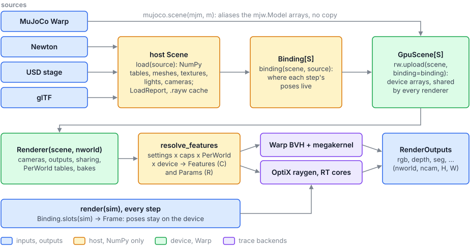
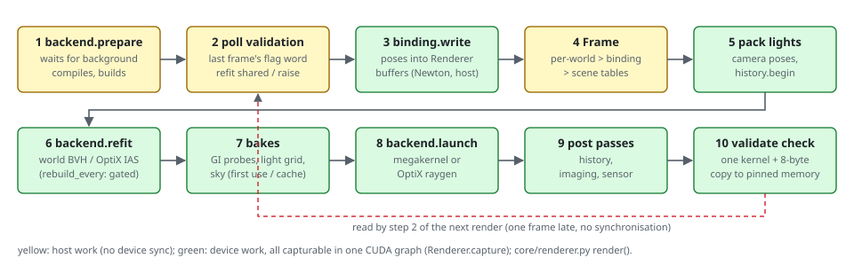
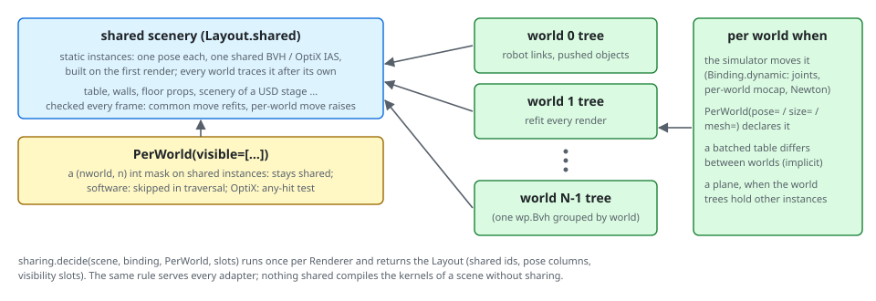
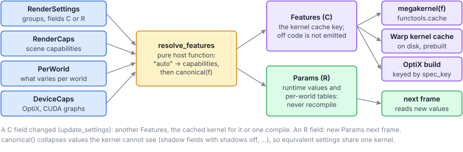
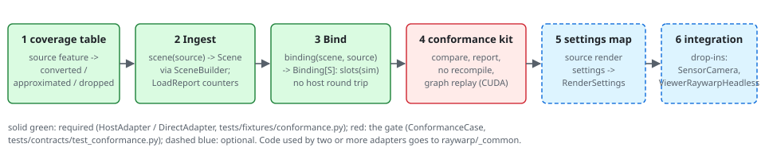

# Developer guide

This guide is for people who change `raywarp`: how the pieces fit, the code standards and how
they are checked, how to test, and how to add a feature or an adapter. The user guide is in
[`docs/README.md`](README.md). The knowledge base in `internal/research/kb/` holds the working rules
(`OPERATING_MANUAL.md`), the current state (`STATUS.md`), decisions, known bugs and the
architecture notes. Older plans and evidence (`internal/research/plan/`, `internal/results/`) are archived in the
HF bucket (see "Evidence paths" in [`docs/README.md`](README.md)). Code establishes implemented
behaviour, not necessarily intended or correct behaviour. Update affected documentation with each
code change, and distinguish implemented behaviour, known limitations and planned work.

Contents:

1. [Architecture at a glance](#1-architecture-at-a-glance)
2. [Package layout](#2-package-layout)
3. [The parts, one by one](#3-the-parts-one-by-one)
4. [Standards S1-S7 and the gates](#4-standards-s1-s7-and-the-gates)
5. [Testing](#5-testing)
6. [Adding a feature](#6-adding-a-feature)
7. [Adding an adapter (playbook)](#7-adding-an-adapter-playbook)
8. [Kernel lab lessons](#8-kernel-lab-lessons)
9. [Commands and utilities](#9-commands-and-utilities)

## 1. Architecture at a glance



A frame goes through five layers:

1. **Sources**: a MuJoCo model, a USD stage, a Newton model. Only adapters know them.
2. **Adapters** (`raywarp/integrations/`: `mujoco`, `newton`, `mjlab`, `isaaclab`;
   `raywarp/formats/`: `usd`, `gltf`) turn a source into a format-neutral **host scene**
   (`raywarp.scene.Scene`, NumPy only, cacheable as a `.wpbr` file) and a **binding**
   (`Binding[S]`), which tells the core where the per-step state (poses) of a simulator state
   `S` lives. MuJoCo is the exception: it goes straight to a `GpuScene` that aliases the
   `mjw.Model` arrays.
3. **Upload** (`raywarp/core/pipeline/upload/`, `rw.upload`) turns a host scene into a **`GpuScene`**:
   the structure-of-arrays the kernels read, shared by any number of renderers.
4. A **`Renderer`** (`core/pipeline/renderer.py`) owns everything per configuration: worlds, cameras,
   output buffers, which instances are shared, per-world tables, bakes. Its settings go through
   **`resolve_features`** (`core/build/variants/resolve.py`), which produces `Features` (compile-time, the kernel
   cache key) and `Params` (runtime values).
5. A **trace backend** (`core/trace/backend.py`) traces the camera rays: the software BVH
   traversal with the megakernel (`core/trace/accel/`, `core/kernels/`), or OptiX on RT cores
   (`core/trace/optix/`), whose ray-generation program is the same per-pixel body. Both write the
   `RenderOutputs` arrays in place.

Two rules hold everywhere:

- **The core never imports a scene format.** `raywarp/core` imports Warp and NumPy only;
  `raywarp/scene` imports NumPy only (and the pure-Python `settings` constants and
  `core/code_version` digests) (`tests/contracts/test_import_boundary.py` checks it). Simulator
  names (`geom_xpos`, `body_q`) appear only in adapters.
- **No host round trip per frame.** Poses, per-world tables and outputs stay on the device; the
  per-frame validation reads its flags one frame late from pinned memory. A step plus a render
  can be captured in one CUDA graph (`Renderer.capture`).

## 2. Package layout

```text
raywarp/
  __init__.py        public API (the host scene and the core, imported eagerly; integrations and
                     formats are imported on their own: `import raywarp.integrations.mujoco`)
  _base/             shared vocabulary, a leaf (types, dims, named tuples, host arguments)
  cache/             the disk caches: cache directory and atomic writes (paths), code digests,
                     `python -m raywarp.cache.prune`
  settings/          RenderSettings, FAST, Outputs, the settings groups and output specs
  scene/             host scene (NumPy only)
    model/           tables, lights, materials, geometry, checks, LoadReport, Scene, .wpbr (wpbr.py)
    images/          decoding, colour spaces, HDR / EXR, mips, the texel blob, latlong layout
    lighting/        Lighting rig, photometry, sky, IES, emissive panels
    build/           SceneBuilder and its mesh / instance / image pools, displacement
  core/              the renderer, by pipeline stage (packages only; device code: the PTX packages
                     of build/kernel_cache/kernel_code.py)
    trace/           getting hits: TraceBackend Protocol and registry, the software and OptiX
                     backends, FrameContext, frame structs, OMM sources
      rays/          (device) camera models, projections, seeds, primary rays, ray bundles
      accel/         (device) software traversal: scene BVHs, mesh BLASes, ordered traversal,
                     deformable BVHs
      optix/         OptiX host side: IAS / GAS, pipeline, launch, graphs, supersampling;
                     device/ (programs, traces, hit programs, params; device code), omm/
    shade/           (device) lighting a hit
      materials/     surface evaluation, BRDF, OpenPBR lobes, layers, maps, textures, UV
      lights/        punctual and area lights / LTC, IES, light grid, loop, pack, sources
      shadows/       punctual shadow rays (visibility), the shadow budget, soft area shadows
      gi/            GI probes, volume, atlas, schedule, relight
      ao/            contact AO
      environment/   environment maps, IBL, latlong (device), fog, background
    post/            the image after the hit
      exposure/      (device) automatic exposure and its HDR source
      grading/       (device) display transform: tone mappers, sRGB, colorimetry, grading, Look
      display/       (device) the deferred display pass, chromatic aberration
      temporal/      (device) the motion output's history, state and per-pixel body
      aa/            FXAA (a plain Warp module)
      sensor/        the sensor pass (rolling shutter, motion blur, noise, depth models) and its
                     inputs (plain Warp modules)
    outputs/         RenderOutputs, ground truth, point clouds, camera export, semantic classes
    pipeline/        Renderer (+ controls, debug), CameraRig, Frame, RenderGraph, bakes,
                     `Renderer.warm`
      gpu_scene/     GpuScene, CameraSpec (gpu_scene.py), Binding[S] and slots (binding.py)
      upload/        host Scene -> GpuScene (build.py: `rw.upload`), materials, lights, meshes
      textures/      texture upload, cache, formats, pool
      worlds/        per-world tables, PerWorld / Layout (sharing), derived fields, validation
      platform/      DeviceCaps (every CPU / CUDA difference), launches, cadence, module lock,
                     bake cache
    build/           what the kernels are built for and where they come from
      variants/      resolve_features, canonical keys, tiers, class sets, tuning, explain, nearby
      kernel_cache/  prebuilt bundle, kernel-code list, store (+ kernels.json), warmup, hashes
    kernels/         (device) the megakernel: pixel.py, surface, lighting, reflections, ambient,
                     layer, first_hit, display, probe; @device_generic (generic.py), native C++
                     builtins (native.py / .pyi)
      abi/           Features, toggles, structs, output layout, tables, queries, counters
  integrations/      simulators and frameworks (each needs its extra)
    mujoco/          aliased mjw Model / Data, MuJoCo Warp's render API, MJX (mjx.py)
    newton/          scenes bound to bodies; drop-ins sensor.SensorCamera,
                     headless.ViewerRaywarpHeadless (imported from their packages: Newton >= 1.7)
    mjlab/           mjlab's RGB renderer entry point
    isaaclab/        an Isaac Lab 3.0 camera renderer on the Newton adapter (cfg, renderer:
                     imported from their modules: they import Isaac Lab)
  formats/           scene files (each needs its extra)
    usd/             stage -> Scene: stage/ (prims, meshes, cameras, lights), materials/ (preview,
                     MaterialX, UDIM, mdl/: MDL bake), render settings map
    gltf/            glTF 2.0 -> USD stage (to_usd.py) read by the USD adapter, content-hash cache
  viewer/            the web viewer (`raywarp view`)
  cli/               the `raywarp` command (view, record, convert, prepare, kernels, cache, info)
  video/             MP4 recording of the `rgb` output (`raywarp record`)
  kernels.py         `rw.kernels`: the prebuilt kernels' switches, info, fetch
  data/              shipped tables (DFG LUT, LTC fits), read with importlib.resources
```

The top-level packages form layers (`tests/contracts/test_import_cycles.py` `test_layers`):
`_base`, `cache` < `settings` < `scene` < `core` < `randomize`, `formats` < `integrations` <
`viewer`; the only upward import is a deferred one (the host scene's "flux as rendered" through
the upload's light derivation, cycle C4). Inside `core`, a package is device code (the PTX list:
`trace.rays`, `trace.accel`, `trace.optix.device`, `shade`, `post.{exposure, grading, display,
temporal}`, `kernels`) or host code, never both; device code reads host modules only through the
`HOST_ONLY` / `HOST_CONSTANTS` names of `kernel_code.py` (`tests/contracts/test_kernel_code.py`).
Module renames by restructure: `internal/research/kb/RESTRUCTURE_MAP.md`.

Tests are in `tests/`, by area (section 5.1); benchmarks, the scene registry and the regression
suite in `internal/benchmarks/` (`internal/benchmarks/README.md`); maintenance scripts in `tools/` (HF jobs and
sandboxes: `python -m internal.tools.hf`, `tools/hf/README.md`; the dev-server client: `internal/tools/dev/`).

## 3. The parts, one by one

### 3.1 Host scene (`raywarp/scene/`)

**What**: the format-neutral description of a scene: instances, meshes, materials, textures,
lights, environments, cameras, plus a `LoadReport` and metadata. NumPy only.

**How**: an adapter fills a `SceneBuilder` (`scene/build/builder.py`: `add_mesh`, `add_image`,
`add_texture`, `add_material`, `add_instance(s)`, `add_light`, `add_environment`, `add_camera`)
and calls `build()`. Materials and textures are deduplicated by value; instances are stored as
column chunks (`scene/model/tables.py`) concatenated at build. `build(path)` writes a `.wpbr` file
(`scene/model/wpbr.py`): every array raw and 256-byte aligned, a JSON header written last, so a crash
never leaves a valid file and a load is one memory map with a zero-copy view per array, whatever
the object count. Freshness is a `CacheKey` (adapter, source path, options, code version) plus
the list of every file read, checked with one parallel `stat`.

**Why**: parsing a large USD stage takes tens of seconds; a cached scene loads in well under a
second, and every adapter shares the cache, the report and the upload.

**Key pieces**: `scene/model/types.py` (`Material`, `Camera`, enums), `scene/model/report.py` (`LoadReport`:
`counts`, `dropped`, `approximated`, `examples`, `timings`), `scene/lighting/emissive.py` (flat emissive
panels as rect lights), `scene/model/lights.py` (light rows and photometric units), `scene/images/decode.py`
(decoding, derived images such as the MDL bakes).

### 3.2 Adapters (`raywarp/integrations/`, `raywarp/formats/`)

**What**: everything format-specific. The contract is the `HostAdapter` / `DirectAdapter`
protocols of `tests/fixtures/conformance.py`, which the conformance test runs on one `ConformanceCase`
per adapter (playbook: section 7):

- **Ingest** (required): `scene(source, **options) -> Scene`, with a `LoadReport` that counts
  every attribute dropped or approximated (`Mesh.primvars:st1`, `mdl.OmniUe4Base.heuristic`).
- **Bind** (required): `binding(scene, source) -> Binding[S]`, rebuilt from the instances'
  source ids (`Instances.source`), so a cached scene binds to a live source.
- **Settings map** (optional): the source's render settings to `RenderSettings`
  (`rw.formats.usd.settings(stage)`, applied explicitly by the user).
- **Integration** (optional): the source's own front ends (Newton `SensorCamera`, `ViewerRaywarpHeadless`).

The adapters:

- **MuJoCo** (`mujoco/`): `rw.integrations.mujoco.scene(mjm, m)` ingests and binds in one step:
  it builds the `GpuScene` directly and aliases the `mjw.Model` tables
  (`geom_rgba`, `geom_matid`, `mat_specular`, ...) by live ids, so replacing them takes effect at
  the next render. `MjwBinding` (`bind.py`) reads poses from the `mjw.Data` of each call.
  `render_context.py` is MuJoCo Warp's `create_render_context` / `render` / `get_rgb` API on top.
  Lights follow MuJoCo's photometric or classic model (`lights.py`).
- **USD** (`usd/`): `rw.formats.usd.load(path, cache=...)` reads the stage into a
  `SceneBuilder` (`stage.py`, `mesh.py`, `gprims.py`, `lux.py`, `shade.py`, `camera.py`,
  `semantics.py`); MDL materials are evaluated or baked to textures (`mdl/`); `bind.py` returns
  `StaticPoses`. `rw.formats.usd.bake` writes a `.wpbr` offline.
- **Newton** (`newton/`): `rw.integrations.newton.load(model)` ingests the model's visible shapes
  into a host `Scene` (`lighting=`: the lights, the headlight as CAMERA / AMBIENT lights), `rw.integrations.newton.binding(scene, model)`
  binds them (`NewtonBinding`: one kernel writes instance poses from `state.body_q`), the caller
  uploads; `load_usd(model, stage)` takes the visuals from the stage instead (bound with
  `binding(scene, model, stage=stage)`: its rigid-body prims).
  `sensor.py` (`SensorCamera`) and `headless.py` (`ViewerRaywarpHeadless`, a `ViewerNull`) are the
  drop-ins.
- **Isaac Lab** (`isaaclab/`): an integration only. `RaywarpRendererCfg` /
  `RaywarpRenderer` implement Isaac Lab 3.0's `BaseRenderer` over `cameras.Cameras` (Isaac's
  calls, no Isaac Lab import: tested with fakes): the scene is the Newton model Isaac Lab builds
  for its renderers (ingested and bound by the Newton adapter), body poses come from Isaac's
  scene data provider (PhysX or Newton physics), each camera is a `CameraSession`, a camera of
  the `CameraGroup` of cameras rendering alike (one Renderer, a world per environment, a camera
  per Isaac camera: `render_batch` renders a group once) writing Isaac's (N, H, W, C) outputs
  (`contract.py`; in place for a camera alone), and
  Isaac's visual-material writes land in per-world color tables (`materials.py`).
- **glTF** (`gltf/`): `rw.formats.gltf.load(path, cache=...)` converts the asset to a USD stage
  (`to_usd.py`, also `raywarp convert`'s) kept by content hash, read by `rw.formats.usd.load`.

Code two or more adapters use lives with what it is about: the image color-space default in
`scene/images/colorspace.py` (`auto_colorspace`), USD prim path relations in `formats/usd/prim_paths.py`
(pxr-free), the foreign-config rule in `settings/render.py` (`mapped`: base, then the
config's set fields, then the user's overrides); format parsing, binding kernels and
integration APIs stay in their adapter. The lighting
every adapter takes (`lighting=rw.Lighting(...)`: lights, ambient, envmaps, headlight)
is format-neutral and lives with the host scene (`scene/lighting/rig.py`, `Scene.with_lighting`).
Every module of a package is public by path: there are no `_`-prefixed modules (privacy is per
name), and a package `__init__` re-exports (`from m import X as X`) only when it is a documented
entry (`raywarp`, `scene`, `settings`, the adapters).

### 3.3 Binding and slots (`core/pipeline/gpu_scene/binding.py`)

**What**: the vocabulary between simulators and kernels. A **slot** is a named array the kernels
read, `<group>.<quantity>` with the groups `instance`, `shared`, `material`, `light`, `camera`,
`flex` (`Slots`, `SLOTS`). Its kernel field is the name with `.` replaced by `_`
(`instance.pos` -> `instance_pos`).

**How**: a `Binding[S]` (an ABC; only `slots(sim)` is required) returns the slot arrays of one
call from the simulator state `sim`. A frame's arrays are, by priority: the Renderer's
per-world overrides, the binding's arrays for the call, the scene's tables. Bindings keep no
per-step arrays; they re-resolve them on every `render(sim)`, so swapped state is picked up, and
a captured graph detects changed arrays (`StaleBinding`). Bindings that cannot alias poses
(Newton gathers `body_q`, USD has static poses) set `writes_poses` and write into
Renderer-owned `PoseBuffers` (`allocate`, `write`, `write_shared`).

**Why**: one contract for zero-copy aliasing (MuJoCo Warp) and gathering (Newton), typed by the
state `S` (`Renderer[S].render(sim: S)`), with no simulator name in the core.

### 3.4 GpuScene and upload (`core/pipeline/gpu_scene/gpu_scene.py`, `core/pipeline/upload/`)

**What**: `GpuScene[S]` is a pure typed record: `tables` (per-instance / material / light arrays
named by slot, batched `(1 or nworld, n)` and read at row `worldid % nrow`), named instances,
static geometry (`Meshes` with their BLASes, height fields, optional `Deformables`), textures,
environment maps, authored cameras, `capabilities` (what the content uses: shape kinds, texture
roles, translucency, mirrors, spot lights, ...) and the `binding`.

**How**: `upload(host, device, binding=None, options=SceneOptions())` (`pipeline/upload/build.py`) maps
the host tables one module per kind: `meshes.py` (shapes, meshes, stretches),
`materials.py` + `texture_pool.py` (materials, textures, per-instance PBR tables), `lights.py`
(punctual and area forms; emissive panels become lights here),
`environment.py` (environment maps, the suns cut out of them, cameras). What the kernels cannot represent is counted in
the host scene's report under `gpu.*`. Textures go up through `core/pipeline/textures/uploader.py` (sRGB
linearisation and mips on the device where `DeviceCaps.device_textures`).

**Why**: every field means the same for every source and is always present (zeros or -1 where a
source has none), so consumers never branch on the source.

### 3.5 Renderer (`core/pipeline/renderer.py`, `core/pipeline/controls.py`)

**What**: renders `nworld` worlds x `ncam` cameras of one `GpuScene`. It owns the camera rig
(`cameras.py`), the output buffers (`outputs.py`), the sharing layout, the per-world tables
(`per_world.py`), the bakes (`baked.py`), the temporal history (`post/temporal/history.py`), the
validation watch (`watch.py`) and the trace backend.

**How**: the constructor decides the layout once (`sharing.decide`), builds its tables, resolves
`Features` and starts compiling the first frame's kernels in the background
(`backend.prepare(wait=False)`, `warmup.py` compiles modules on a thread pool). Each
`render(sim)` then runs the steps below; `update_settings(**changes)` re-resolves and switches to
the matching cached kernel, dropping only the structures a changed field's metadata names.



**Sharing** (`core/pipeline/worlds/sharing.py`): an instance is per world when the simulator moves it
(`Binding.dynamic`: MuJoCo joints, mocap bodies posed differently per world in the build's
`d`), when the Renderer's `PerWorld` declares a pose / size / mesh for it, when a
batched table differs between worlds, or when it is a plane next to per-world instances. Every
other instance is shared scenery: one pose and one entry in a shared BVH / OptiX IAS that every
world traces after its own tree. `PerWorld(visible=...)` is a per-world mask that keeps
instances shared.



**Validation** (`core/pipeline/worlds/validator.py`, `core/pipeline/worlds/watch.py`): after each frame one small kernel compares
the shared instances with the snapshot the shared trees were built from, checks index tables
("env.id", "instance.mesh") and baked-from-world-0 lighting, and writes a flag word copied to
pinned memory. The next render reads it without synchronising: shared scenery is static, so a
shared instance that moved or changed (in any world) raises with the `PerWorld` fix.

**Per-world tables** (`core/pipeline/worlds/tables.py`): every per-world field is declared at construction
(`PerWorld(material=..., light=..., camera=..., env=...)`); its `(nworld, n)` table is allocated
then, and the declaration (not the writes) decides what is compiled in, so writing a table never
reconfigures and a captured graph keeps reading the same memory.

### 3.6 Settings, resolve_features and Features (`settings/`, `core/build/variants/resolve.py`)



**What**: `RenderSettings` is a frozen dataclass of frozen groups (`outputs`, `aa`, `shadows`,
`lighting`, `environment`, `reflections`, `transparency`, `gi`, `openpbr`, `surfaces`, `post`,
`atmosphere`, `exposure`, `grading`, `lens`, `sensor`, `performance`), one module per family in
`settings/`. Whether a field is
compile-time (C) or runtime (R), and what a change rebuilds, is field metadata
(`settings/fields.py`: `setting(default, ge=...)`, `runtime_field(default, rebuild=None, ge=...)`,
`rebuild_field(default, rebuild)`), listed by `RenderSettings.fields_table()`. Validation is
derived from the annotations (bool, int, float, `Literal` choices, `Tri`, optional `None`) and
the limits of the field helper (`ge` / `gt` / `le` / `lt`; `lt=math.inf`: finite) by
`fields.validate`; an enumerated setting's `Literal` alias (`ToneMapperName`, ...) is its one list
of choices, and its id table (`TONE_MAPPERS`, ...) is built from it. Never keep a hand-written
list of runtime fields: the tables of `docs/settings.md` and `README.md` are generated from it
(`python tools/settings_table.py --write`; `tests/tooling/test_docs.py` fails when they are stale).

**How**: `resolve_features(settings, caps, per_world, device) -> (Features, Params)` is a pure
host function. "auto" values resolve against `GpuScene.capabilities` and the `PerWorld`
declaration (a per-world `material.mirror` compiles the mirror reflectance in). Then `canonical(f)`
collapses values the kernel cannot see (shading fields of a depth / segmentation-only render,
shadow fields with shadows off, a shadow budget covering every light, layer count without
transparency, mesh fields without meshes), so equivalent settings
share one kernel (`tests/unit/test_canonical_features.py`). `Features` (`kernels/abi/features.py`, built
only by `resolve_features`, no defaults) is the key of the process-wide kernel cache
(`kernels/pixel.py` `megakernel` is a `functools.cache` on it) and of the OptiX build
(`trace/optix/launch.py` `spec_key`); compiled modules persist in Warp's on-disk kernel cache.
`Params` (`kernels/abi/structs.py`) carries the continuous values; per-world tables carry the rest.

**Why**: a feature that is off costs nothing (its code is not emitted), and continuous knobs
(exposure, roughness thresholds, fog, every per-world table) change without recompiling.

### 3.7 The megakernel (`core/kernels/` and the other device packages)

**What**: one thread per (world, camera ray). `kernels/pixel.py` `make_render_pixel(f, tracer)`
builds the per-pixel body: for each sub-pixel sample, trace the primary ray, shade the hit
(`kernels/surface.py`; lights with ray-traced shadows `kernels/lighting.py`,
`shade/shadows/visibility.py`; split-sum ambient; emission), optionally a glossy reflection ray
(`kernels/reflections.py`; a MuJoCo mirror is a specular F0 like any), continue through translucent layers, then fog, tone map
(`kernels/display.py`) and write the outputs.

**How**: factories (`make_*`) compose named `wp.func` pieces specialised with `wp.static(f.x)`
branches; the top-level factory wires them. The same body is the software megakernel
(`megakernel(f)`), the OptiX ray-generation program and the temporal body
(`post/temporal/pixel.py`).
Kernel inputs are grouped into structs (`kernels/abi/structs.py`, filled per frame by
`trace/frame_structs.py`, which only copies array descriptors and is cached by array identity).
`shade/materials/` holds the shading maths (Filament BRDF `brdf.py`, materials, texture maps);
`trace/rays/` the camera models, projections and ray bundles; `shade/environment/` IBL `ibl.py` /
`envmap.py`, fog and the background; `shade/lights/` the lights (punctual, LTC area lights, light
grid, light pack and caps); `shade/shadows/` the shadow rays and the shadow budget; `shade/gi/`
the GI probes; `post/exposure/`, `post/grading/` (tone mapping, sRGB, grading) and
`post/display/` the display passes; `post/temporal/` the motion output's history; `kernels/abi/` the
`Features`, structs, toggles and counters.

**Why**: one specialised kernel per configuration keeps registers and branches to what the
scene and settings use; one body for both backends keeps their pixels identical.

### 3.8 Trace backends (`core/trace/backend.py`, `core/trace/accel/`, `core/trace/optix/`)

**What**: a `TraceBackend` owns one Renderer's acceleration structures and the launch of its
frame; the Renderer never tests which one it holds. `trace_backend.named(features.traversal)` gives the
class (`performance.traversal`: "auto" takes OptiX on GPUs with RT cores, by device capability).

**How**, in frame order: `configure(ctx)` after the Features change, `prepare(ctx, wait)`
(compiles, builds), then per frame `refit(ctx, frame)` and `launch(ctx, frame, seed)`. The
shared scenery's structures are built once (it is static). The ray queries a kernel body calls
are a `Tracer` (`kernels/abi/rays.py`).

- **Software** (`trace/software_backend.py`): a world BVH (one `wp.Bvh` over every world's per-world
  instances, grouped by world, refit every render; `performance.rebuild_every` rebuilds the
  topology on the device's cadence) plus the shared BVH (`trace/accel/bvh.py`), mesh BLASes
  (`trace/accel/meshes.py`), nearest-first ordered traversal through our C++ node accessors
  (`trace/accel/ordered.py`, `trace/accel/nodes.py`, `core/kernels/native.py`), deformables (`trace/accel/deformable_bvh.py`).
  Its tracer also serves every software ray kernel (GI probes, light grid),
  whatever backend renders the camera rays. Ordered and unordered scene queries retain the
  current child separately from their 32-entry pending-node stack, including single-tree
  scenes, so depth-32 SAH leaves remain reachable. Direct node access is validated for the Warp
  families `trace.accel.nodes.VALIDATED_WARP` (1.18; 1.19 is excluded for its sm_120 texture
  regression, warp#2258; pyproject caps warp-lang to them); other families
  raise an actionable compatibility error before compilation. Every private Warp use is fenced
  in tests/contracts/test_warp_private.py, which a Warp upgrade runs first.
  Warp 1.18's public scene query is not a safe fallback at this depth. Extending support requires
  the fence, node-layout and deep-tree tests on CPU and CUDA; analytic primitive intersections are
  independent of this traversal change.
- **OptiX** (`optix/`): per-world and shared IASes over static GASes (`accel.py`, `gas.py`),
  programs compiled to PTX once per build (`programs.py`, `pipeline.py`), launch parameters
  (`params.py`, kept under the 8 KB by-value limit), `spp > 1` as a supersampled image
  (`supersample.py`), CUDA graphs cut around the OptiX launches (`graph.py`), the host API
  through ctypes over the driver's function table (`api.py`; module compile in parallel tasks,
  `context.py`). Nothing loads the driver's OptiX at module import time. Backend choice (`core/trace/backend.py`, by device capability):
  `traversal="auto"` is OptiX on GPUs with RT cores (`DeviceCaps.rt_cores`) and the software
  traversal on the CPU, on compute GPUs (A100, H100) and for dim-1 flex scenes (height fields,
  SDFs and flex surfaces are OptiX triangle GASes, `core/trace/optix/dynamic.py`);
  there is no fallback (an RT-core GPU whose driver lacks OptiX 9.0 raises).

### 3.9 Bakes, caches and warm (`core/pipeline/baked.py`, `core/pipeline/platform/bake_cache.py`, `core/pipeline/warm.py`)

**What**: precomputed lighting over static shared geometry: the light visibility grid
(`shade/lights/grid.py`) and the GI probe volume (`gi/`), plus the environment
prefilter / SH at upload.
Dynamic/per-world geometry and deformables are excluded from every bake ray and probe-placement
survey; probe bounds also exclude them. Shared GI is omitted/reported for per-world lighting or
material inputs, including multi-row simulator arrays. Light-grid validity is checked from the
packed light table each frame on device: changed rows and points outside its bounds evaluate all
lights. The grid's all-active bake also supports lights activated after preparation.

**How**: `Baked` builds each one when needed (the grid on the backend's hardware when it can):
on the first frame and whenever what it was built for changes (`grid_key` / `probe_key`: the
Features of its kernel and the settings tagged `rebuild=`), and bumps `generation` on a
replacement so the kernel structs rebuild. Each bake is a pure function of
its inputs, so `bake_cache.py` stores it as `<cache>/bakes/<kind>/<digest>.npz`, the digest over
every struct array it reads, host values, the `raywarp.core` sources and the device kind: a hit
is bit-identical to a fresh bake. The directory is `$RAYWARP_CACHE_DIR` (default
`~/.cache/raywarp`; empty disables it). Periodic GI updates are gated on the device
(`core/pipeline/platform/cadence.py`), so a captured graph replays them. `Renderer.warm` (`core/pipeline/warm.py`) runs a
renderer of the constructor's arguments and one frame in the background (a future; device steps
one warm at a time per device) to fill the kernel, OptiX module, structure and bake caches.

### 3.10 Outputs and graphs (`core/outputs/render_outputs.py`, `core/pipeline/graph.py`)

`RenderOutputs` holds dense world-major `(nworld, ncam, H, W)` arrays named as requested (`rgb`
in its `ColorOutput` layout, `depth`, `seg`, `hdr`, `albedo`, `normal`, `motion`, ...; per-camera
views in `cameras`), written in place every frame; `torch()` returns zero-copy views created once.
`Buffers` allocates them or aliases caller arrays (`Renderer.bind_outputs`). `Renderer.capture`
runs a step and a render once, then captures both in a `RenderGraph`; `launch(sim)` checks the
arrays and the renderer's `_graph_version` (`r.debug.graph_version()`) and raises `StaleBinding` when something changed.

### 3.11 Device differences (`core/pipeline/platform/device.py`)

Every CPU / CUDA difference goes through `device_caps(device)` (`graphs`, `pinned`,
`device_textures`, `optix`, ...). No module tests `device.is_cuda` or the arch itself. A new
device kind fills the same record.

## 4. Standards S1-S7 and the gates

Every change follows the standards S1-S7 (section 4.1) and the code-quality rules (section 4.2);
the gates (section 4.3) enforce what tools can check.

### 4.1 Standards S1-S7

**S1. Typing.**

- `from __future__ import annotations` in every module. Rule that makes it safe for device code
  (Warp evaluates kernel / func annotations with the closure as locals, and a name used only in an
  annotation is not a closure variable): types in `@wp.kernel` / `@wp.func` / `@wp.struct`
  signatures are module-level names; a test builds every factory variant to catch a NameError.
- **Host code**: every array annotation shaped, with named dimensions as PEP 695 type parameters
  (`def f[NWorld: IntVar, N: IntVar](x: wp.array[wp.vec3, [NWorld, N]])`), `IntVar` imported
  under `TYPE_CHECKING`. Shared dimension names (`NWorld`, `NCam`, `H`, `W`, `NInstance`,
  `NLight`, `NMaterial`, ...) are documented in one place (`raywarp/_base/dims.py`, type-only).
  Shaped aliases via PEP 695 `type` statements.
- **Device code** (`@wp.kernel`, `@wp.func`, `@wp.struct`): annotations stay plain Warp
  (`wp.array2d[wp.vec3]`) because Warp evaluates them; shapes are carried by the typed host
  launcher that allocates outputs from inputs.
- Generic device helpers use a PEP 695 type parameter and `@device_generic`
  (`raywarp/core/kernels/generic.py`) under `@wp.func`: pyrefly infers exact types at call sites, Warp
  sees its `Any` generic placeholder (generated code identical to a hand-written version).
  Pyrefly does not see Warp's same-name overloading, so variants get distinct names (`batched`,
  `batched1d`). Warp's own `wp.Scalar` / `wp.Float` / `wp.Int` are kept as is.
- **Factories have no return annotation.** A function that builds and returns callables (`make_*`,
  `_make_*`, any function returning a closure, a `@wp.func` or a `@wp.kernel`, or a tuple of them)
  leaves its return type to Pyrefly's inference: simpler, and exact for generic factories. A
  `Callable` alias (`type X = Callable[...]`) exists only where it types a parameter, an attribute
  or a variable (a callback argument cannot be inferred); one with no such use is deleted. The
  `unknown-return-type` sub-configs pass on inferred types. Exceptions: overloaded factories
  (the overloads are the contract), decorators (`concrete`, `specialize`: their return is generic
  over the decorated function) and `trace.instance_pose` (Pyrefly 1.4 infers the scalars of a
  tuple of Warp vectors returned through `@wp.func` as Unknown:
  `research/upstream/pyrefly_inferred_tuple_args.md`).

```python
# docs: skip (illustration; the helper is raywarp/core/kernels/abi/tables.py)
@wp.func
@device_generic
def batched[T](table: wp.array2d[T], worldid: int, i: int) -> T:
  return table[worldid % table.shape[0], i]
```

- No `Any`, no `dict[str, Any]`. Central objects have real types: `Renderer`, `GpuScene`,
  `Layout`, `Features`; the simulator binding is the generic `Binding[S]` ABC, the trace backend a
  `TraceBackend` Protocol, the OptiX handles a typed wrapper. Simulator states are the type
  parameter `S`. `if TYPE_CHECKING:` only for imports.
- No dynamically created attributes: declared fields.
- Optional values narrowed before use; no `# pyrefly: ignore` for our own mistakes.
- Stub gaps are fixed in pyrefly-warp-stubs, not suppressed here; until released, one tagged
  ignore per site, listed in `internal/research/upstream/pyrefly_stub_gaps.md`. Our own native builtins
  (`wp.mjpbr_*`, registered at import by `core/kernels/native.py`) get a local `.pyi`.
- Process-wide caches keyed by `Features` use `functools.cache` on the factory, not hand-written
  `dict[Any, wp.Kernel]` with ignores.

**S2. Kernel / func signatures.** Argument groups commented MuJoCo-Warp style: `# Model:`,
`# Data in:`, `# In:`, `# Out:`. No unused parameters; exception: a Protocol method whose
interface needs the argument (part of a typed contract, e.g. `Binding.slots(sim)`, marked
`@override` in implementations). Long parameter lists are grouped into `@wp.struct`s (the
`Geometry` pattern) where it does not cost registers (measured).

**S3. Function size and structure.**

- Target <= ~60 lines, hard cap 80, for host and device code.
- Kernel factories (`make_*`) compose smaller factories: each piece is a named `wp.func` built by
  its own `make_*`, specialised with `wp.static`, and the top-level factory wires them (example:
  `make_cast_ray` -> traversal, instance resolution, pose, per-type intersection, hit merge).
  `continue` cannot cross a `wp.func` (pieces return a skip flag); traversal stacks stay in the
  caller.
- Large host methods are split into steps with typed intermediate results (dataclasses), not
  into helpers that pass 15 arguments. Module-level helpers over closures where nothing is
  specialised.

**S4. Kernel performance.** Every kernel / func gets a pass for dead parameters, recomputed
constants, redundant normalisations, loads that can be skipped when a weight is 0, work that can
move to upload time, and cheaper closed forms (e.g. box bounds as `|R| @ size` instead of 8
transformed corners). No change may alter images beyond the regression tolerances unless it is a
listed bug fix.

**S5. Documentation in the code.** Every function, method and class (kernels and funcs included)
has a docstring: one line saying what it does, more only when needed. Complex bodies are
structured into commented steps: an inline comment before each non-obvious block says what it
does and why (math, conventions, invariants).

**S6. Structure and abstractions.**

- Files <= ~500 lines (soft cap); larger ones are split by responsibility.
- Pluggable roles are `typing.Protocol`s (structural, for user implementations) or ABCs (when
  shared behaviour is inherited): bindings, trace backends, adapters, output buffers.
- Generics (PEP 695) wherever a type varies; anonymous dicts become dataclasses / TypedDicts.
- Backend / device differences go through one place: the resolved `DeviceCaps` record plus a
  backend Protocol, not scattered `is_cuda` / `hasattr` checks. No version probes (the minimum
  Warp is pinned in `pyproject.toml`).
- Each package's `__init__.py` re-exports its public API; users never import internal modules.
  Internal code imports from the defining module.
- Data files (`raywarp/data/*.npz`) ship as package data and are read with
  `importlib.resources.files("raywarp.data")`.

**S7. Enforcement**: the gates of section 4.3, all at 0.

### 4.2 Code-quality rules (every file)

1. **Keyword-only parameters.** Functions and constructors with more than ~3 parameters, or
   several parameters of the same type, take them keyword-only (`*`); dataclasses use
   `kw_only=True` where positional construction is fragile. Call sites pass keywords. (Warp
   kernel `inputs=[...]` lists are positional by API: see rule 11.)
2. **Shape types everywhere.** Shaped Warp / NumPy annotations with named, semantic `IntVar`
   dims bound from inputs, generic classes where dims bind at construction, output-only named
   dims for computed sizes, `cast` only at untyped library boundaries. Follow pyrefly's upstream
   shape-typing guide: faithfulness first, precise contracts at boundaries, keep known rank and
   dim names, never replace a bound dim by `int` to silence the checker, verify inference with
   `reveal_type` / `assert_type`.
3. **Validate physical parameters at the boundary.** Reject invalid dimensions, sizes and
   counts, non-finite radiance, intensities, colours and transforms, invalid cone angles,
   roughness / metallic outside [0, 1], zero normals / directions, empty meshes, out-of-range
   indices, with an actionable message at the public entry (builder, adapter, settings, upload),
   never deep in a kernel.
4. **No redundant conversion** (`int()` of an int, `np.asarray` of an array, float round trips,
   repeated `.numpy()` / `wp.array(...)` of the same data, dtype casts back and forth).
5. **One helper per concept**, shared across modules and adapters.
6. **`@dataclass(slots=True, frozen=True, kw_only=True)`** for value records where it fits; not
   for classes that need `__dict__` (`functools.cached_property`, monkeypatched fakes): say why.
7. **Explicit `None` vs 0.** Never use 0 / falsy as "unset": `None` means default; 0 and negative
   values are validated and rejected.
8. **Bound peak memory** in parallel work: limits bound what workers actually hold, not only
   what is retained (a byte-weighted semaphore covering in-flight work).
9. **Concurrency correctness.** No races in polling / status, futures' exceptions propagated,
   shared caches locked, no check-then-act on shared state, thread pools shut down.
10. **No unnecessary GPU -> CPU transfers** (`.numpy()`, `wp.synchronize`, implicit host reads)
    outside setup; none per frame unless it is the requested output.
11. **Kernel argument lists.** Replace long positional kernel argument lists (more than ~10-12,
    or groups that always travel together) by a cached `@wp.struct` when it reads better and
    does not cost a per-launch rebuild (check codegen / registers).
12. **Simple launch caching**: one obvious way to cache launches / graphs / structs, keyed
    completely, invalidated explicitly.
13. **Integer overflow.** Warp's `int` is 32-bit: indices and offsets that can exceed 2^31 - 1
    (worlds x cameras x pixels, texel offsets in big atlases, byte sizes) use `wp.int64` (and
    int64 host arithmetic), with a test at the boundary size.
14. **Type-safe optional fields**: `X | None` narrowed explicitly (no `assert` as the only guard
    in library code, no `or` defaults where 0 / "" are valid), sentinels typed, no Optional field
    that is always set.
15. **Fail fast, fail loud**: no bare `except`, no swallowed errors, specific exception types,
    messages that name the value, the expected range and where it came from.
16. **No silent fallbacks**: a feature that cannot run raises; it never silently degrades. No
    string references to code (module or field names) without a check that fails when they go
    stale.
17. **Explicit devices**: every allocation and launch names its device; no reliance on Warp's
    process-wide default device.
18. **Numerical robustness in device code**: guard divisions, normalise only non-zero vectors,
    clamp `acos` / `sqrt` inputs, keep NaN out of accumulations; named, documented epsilons.
19. **Named constants with units** (`_M`, `_NITS`, `_DEG` or documented), no magic numbers.
20. **Closed sets as `Literal` / `IntEnum` / `StrEnum`**; `match` over isinstance chains where it
    reads better; exhaustive handling (`assert_never`).
21. **Small, single-purpose functions** (target < 40 lines, hard 60 for host code), early
    returns, shallow nesting, no flag arguments that switch between two functions' worth of
    behaviour.
22. **Resource lifetime**: files, mmaps, OptiX / CUDA handles and thread pools are closed by
    context managers or owners; no leaks across Renderer rebuilds.
23. **Mutable state**: no mutable default arguments, no module-level mutable state except caches
    with complete keys and a documented lifetime.
24. **Comments tell why, and are true**: no stale comments, no commented-out code, no TODO
    without an owner; no research, lane or bug-id citations in docstrings.
25. **Names**: semantic, one name one meaning across the package, units in names or docstrings
    for physical quantities, US spelling.
26. **Tests**: every bug fix has a test that fails before it; tests assert behaviour against a
    spec or reference, not implementation details; no test that cannot fail.
27. **pyrefly strictness.** Every `# pyrefly: ignore` names its error code and a reason; no unused
    ignores; the stricter error kinds of `[tool.pyrefly.errors]`; `reveal_type` / `assert_type`
    checks for key shape contracts.
28. **`NewType` ids** for indices into different tables (`MaterialId`, `TextureId`, `MeshId`,
    `LightId`, `InstanceId`, `WorldId`, `CameraId` ...) in host code.
29. **`@typing.override`** on every override, **`@final`** on classes not meant to be subclassed,
    **`Final`** on module constants, **`ClassVar`** on class constants.
30. **PEP 695 only**: `type` aliases, `def f[T]`, `class C[N: IntVar]`; no legacy `TypeVar`.
31. **`@overload`** where the return type depends on an argument.
32. **Narrowing helpers** with `TypeIs` / `TypeGuard` instead of `cast`.
33. **Accept abstract, return concrete** (`Sequence` / `Mapping` in, `list` / `dict` / `tuple`
    out); tuples for constant sequences.
34. **One record kind per role**: frozen dataclasses for values, `NamedTuple` only where tuple
    unpacking is the point, `Protocol` for interfaces, ABC only with shared implementation.
35. **Explicit Warp types in device code** (`wp.float32`, `wp.int32`, `wp.int64`, `wp.uint64`).
36. **`wp.constant` for compile-time constants, `wp.static` for specialisation**; no implicit
    capture of mutable Python globals in kernels.
37. **`wp.empty` instead of `wp.zeros`** when every element is overwritten.
38. **No `wp.ScopedDevice` in library code**: pass `device=` (rule 17).
39. **Repeated launches**: CUDA graphs where possible, else reused `wp.launch(...,
    record_cmd=True)` `Launch` objects; one launch-caching pattern (rule 12).
40. **Readback**: pinned host buffers + `wp.copy` on a stream for host reads; never `.numpy()` on
    CUDA arrays on a hot path.
41. **Warp generics** (`typing.Any` parameters + `wp.overload`) for device functions whose
    variants differ only in types: the one documented exception to "no `Any`" (device code only).
42. **Debug mode**: the CPU suite also passes with `--warp-debug` (array bounds checks) and
    `--warp-verify-fp` (NaN / inf after launches). A failure there is a bug.
43. **hypothesis** property tests for validators, transforms, packing and BVH invariants where a
    change touches them.
44. **Coverage and dead code**: untested code in the files a change touches is listed (pytest-cov)
    and tested where it matters; dead code reported by `vulture raywarp --min-confidence 80` is
    removed once confirmed.
45. **ty** (Astral) is a second, non-blocking type checker (`uvx ty check`), run by hand.

**Protocol or ABC (rule 34).** A `Protocol` for an interface we consume: third-party objects,
dependency inversion (a lower module names what it needs from a higher one: `graph.Replayable`,
`shade.gi.volume.GiRays`), Warp struct schemas (`kernels.abi.rays.GeometryFields`: `@wp.struct` classes cannot
inherit) and value-shaped records (`TraceFeatures`). An ABC only when the implementations share
real default behaviour or state and are subclassed outside the defining module (`bind.Binding`).
Never `@runtime_checkable` (it checks only that the names exist, and slowly); implementations stay
`@final`. `TraceBackend` is a Protocol: its two `@final` backends share no state, `select` calls
their `ClassVar`s and static methods on the class, nothing `isinstance`s them, and
`BACKENDS: Final[tuple[type[TraceBackend], ...]]` checks each one's conformance at the registry.

**Ruff target.** The codes below are being adopted: fix them in every file you touch; each joins
`select` in `pyproject.toml` once the tree is clean (until then they are `external`, so
documented `# noqa: <code>  # reason` comments survive RUF100). Check with
`uv run ruff check --preview --select $TARGET <files>`:
`TARGET = PLR0913,PLR0917,FBT,ANN,PLR2004,SIM,RET,PIE,FURB,PLC0415,PTH,N,SLF,PERF,PYI,S101,T20,ERA,A,PLW0603,D417,TRY300,TRY301,TRY400,B904`.
Settings to aim for: max-args 5, max-positional-args 3, complexity 10 and 40 statements for host
code (device code keeps 15 / 60). Allowed exceptions, each documented with a reason: Warp device
code (positional parameters by Warp's API, math-style names, magic numbers as named
`wp.constant`s) and function-local imports of optional heavy dependencies.

### 4.3 The gates

Run them before a merge or a checkpoint, not after every edit (no GitHub workflow runs them: the CI
builds and publishes the release only).

```bash
uv run ruff check .                                  # ANN401, ARG, D (docstrings), C901 <= 15, PLR0915 <= 60
uv run ruff format --check .                         # 2-space indent, 128 columns
uv run pyrefly check                                 # 0 errors (raywarp + every test file)
```

- **ruff** (`pyproject.toml` `[tool.ruff]`): tests, benchmarks and tools are exempt from the
  docstring, typing, unused-argument and complexity rules selected by ruff. Separately, pyrefly
  checks `raywarp/` and every test file. `pre-commit install` runs ruff on commit
  (`.pre-commit-config.yaml`).
- **pyrefly** (`[tool.pyrefly]`, preset `default`): needs the `typing` extra (shape-aware Warp and
  NumPy stubs, MuJoCo stubs), pulled in by the `dev` group. The `typing` extra requires
  pyrefly-warp-stubs 0.1.3 or newer (integer operators on Warp scalars, `wp.ref[T]`,
  `wp.kernel(fn, **options)`, vector-dtype arrays, ...: `internal/research/upstream/pyrefly_stub_gaps.md`).

## 5. Testing

### 5.1 CPU test suite

CPU-compatible tests run on Warp's CPU device; GPU-only and unavailable-dependency tests skip.
During development run only relevant tests. Pandora is light-use only (a few tests at `-n 2`);
full regular / debug suites and regression checks run on HF at lane / phase completion.

```bash
uv sync --all-extras --group bench
uv run pytest -n 24                # on HF (section 5.3)
uv run pytest -n 24 --warp-debug   # on HF: bounds-checking build
uv run pytest -n 2 tests/contracts/test_api.py -k per_world   # focused local check
```

Layout (`tests/`), one file per feature (lane-split files are merged):

| Directory | What it tests |
|---|---|
| `unit/` | host-side units: BVHs, Sobol, LTC, lobes, photometry, textures, bake keys, upload, warmup, the default settings' snapshot (`unit/test_default_settings.py`) |
| `render/` | CPU end-to-end per feature: shading, materials, lights, light grid, shadows, GI, IBL / envmaps, temporal, reflections, outputs and layouts, imaging, `rw.randomize` |
| `optix_backend/` | the OptiX backend: host logic through a fake OptiX function table (`test_optix_host.py`, CPU), the GPU parity / lifetime tests (`test_optix.py`, skip without OptiX) |
| `adapters/{mujoco,newton,isaaclab,usd,gltf}/` | one directory per adapter (`usd/`: USD, MDL, MaterialX, images, `.wpbr` caches) |
| `contracts/` | API and runtime contracts: import boundary, keyword-only, Warp runtime, conformance kit, typing contracts (`typing_*.py`, checked by pyrefly) |
| `calibration/` | light units and emission |
| `tooling/` | docs, CLI, packaging, glTF converters, asset manifests, webui backend, `python -m internal.tools.hf` |
| `bench/` | the benchmark tools: runner, registry, regression harness, gallery, loop, corpus |
| `fixtures/`, `data/` | shared helpers and fakes (`from fixtures import optix_fake`), test data |

A test file imports helpers of its own directory or of `fixtures/` (and `conftest`: `REPO`,
`DATA`, `make_scene`, ...), never a test file of another directory. GPU-only tests skip on the
CPU; they run on an HF GPU job (`python -m internal.tools.hf run --flavor l4x1 -- 'python -m pytest
tests/optix_backend ...'`).

The lock has a second fork for Newton's SolverMuJoCo (`internal/benchmarks/loop.py`): the
`newton-sim` dependency group holds Newton's `[sim]` MuJoCo / MuJoCo Warp pins, older than the
latest pair the `mujoco` extra locks. Use a separate environment for it:
`UV_PROJECT_ENVIRONMENT=.venv-sim uv run --group newton-sim --group bench --extra newton ...`.

`conftest.py` (the repository root, serving `tests/` and `internal/tests/`) renders MuJoCo scenes from inline XML (fixture `scene(xml, ...)`, every
extra keyword a `RenderSettings.replace` key) and points the bake cache at a temporary directory.
Tests that need assets look them up under `$MJPBR_ASSET_DIR` (`python internal/tools/fetch_assets.py`)
and skip without them. Run only the tests related to a change while developing; the full suite
before a checkpoint.

`--warp-debug` does not enable `--warp-verify-fp`; floating-point verification is a separate
opt-in mode; the debug suite is not a gate yet. Inspect skip reasons and the
actual tested environment when interpreting a passing suite.

Tests worth knowing:

- `tests/unit/test_canonical_features.py`: equivalent settings resolve to one kernel.
- `internal/tests/bench/test_cost_guard.py`: each configuration (unlit, `FAST`, the default, the recipes) is
  clearly cheaper than the next richer one (CPU),
  so a feature switched off cannot silently stop saving time.
- `tests/contracts/test_conformance.py`: the adapter conformance kit on MuJoCo, USD, Newton and Isaac Lab
  (through fakes of Isaac Lab's renderer objects, `tests/fixtures/isaaclab_fake.py`; the end-to-end run,
  `tests/adapters/isaaclab/test_isaaclab_integration.py`, needs Isaac Lab and CUDA).
- `tests/contracts/test_import_boundary.py`: `core`, `scene` and `_common` import no scene format.

### 5.2 Regression suite (`internal/benchmarks/regression.py`)

A declarative list of cases (scene, view, resolution, recipe, seed, frame) rendered on the CPU
with software traversal and compared with recorded references (mean FLIP, max difference,
channel drift, NaN / inf). References live outside git
(`$MJPBR_REGRESSION_DIR/<tag>`, default `~/.cache/raywarp/regression/<tag>`); the manifest is
committed (`internal/benchmarks/baselines/regression_<tag>.json`). The current tag is the one of the
manifest in `internal/benchmarks/baselines/` (`perf1`); its references are in the bucket
(`regression/perf1.tgz`).

```bash
uv run python internal/benchmarks/regression.py list --tag perf1 --case 'cornell*'
uv run python internal/benchmarks/regression.py check --tag perf1 --workers 4 --case 'cornell*'
uv run python internal/benchmarks/regression.py record --tag <new-tag>     # only for an explained pixel change
```

Deterministic cases pass at <= 1/255 per channel and mean FLIP <= 0.01; stochastic cases
against the difference between two recorded seeds. `check` writes `report.md` and
`failures.png` (reference | new | difference). Predict which cases a change alters before you
run it, and explain every changed pixel before recording a new tag. `check --exact` fails every
case that is not bit-identical; `check --device cuda:0 [--traversal optix]` renders on the GPU
against the CPU references: the CPU / GPU parity check of the whole suite.

### 5.3 HF jobs and sandboxes (`python -m internal.tools.hf`)

Everything heavier than a few tests runs on Hugging Face through one CLI (rules, flavors, caches,
spend tracking: [tools/hf/README.md](../tools/hf/README.md)). A run uploads the committed `HEAD`
of the worktree; tag it with the lane.

```bash
python -m internal.tools.hf run --tag my-lane-cpu --flavor cpu-performance --timeout 1h --wait -- \
  'python -m pytest -q -n 8 tests'                                     # the CPU suite (OOM at -n 8 on cpu-upgrade)
python -m internal.tools.hf run --tag my-lane-reg --flavor cpu-upgrade --timeout 1h --wait -- \
  'python internal/benchmarks/regression.py check --tag perf1 --workers 8'       # the regression suite
python -m internal.tools.hf run --tag my-lane-gpu --flavor l4x1 --timeout 30m --wait -- \
  'python -m pytest -q -n 2 tests/optix_backend tests/render'           # GPU shards
python internal/benchmarks/run.py launch --spec internal/benchmarks/specs/per_merge.json --flavor rtx-pro-6000 \
  --source base=core-refactor --source cand=HEAD                         # perf A/B (internal/benchmarks/README.md)
python -m internal.tools.hf ps | logs <run> | fetch <run> | kill <run>
```

### 5.4 The warm dev server (`wpbr-dev`)

For looking at renders while developing: the dev server (`python -m internal.webui`) keeps scenes, kernels
and renderers warm on an HF GPU sandbox; `internal/tools/dev/wpbr-dev` drives it (`wpbr-dev up`,
`sync`, `render SCENE`, `video SCENE`, `ab SCENE`, `profile SCENE`, `bisect settings|commits`,
`forward` for the browser viewer, `down`). Every registry scene of `internal/benchmarks/scenes.py` is
selectable and renders as every other tool renders it (its lighting, views and exposure come from
the registry entry). Stop the sandbox when done (`wpbr-dev down`).

### 5.5 Evidence

A change that can affect speed, cold start or pixels lands with numbers or images: a report folder
under the git-ignored `internal/results/`, mirrored to the HF bucket, and cited by its bucket path. A bug
fix lands with a test that fails before it. Keep evaluations small: one scene, one size, the two
or three variants being compared.

### 5.6 Ground truth for look decisions

Which reference decides what (user decision, 2026-10-28, `internal/results/history/review_c/robotics_fit/`):

- **Look decisions (the default settings, tone mapper, GI on or off, occlusion, light transport):
  Mitsuba 3 path tracing on a small robotics set**, at the target resolution (512-1024 px): the
  pick table (`pick0`), the env-lit bin (`bin0`) and the MuJoCo validation scenes. Tooling:
  `internal/benchmarks/quality.py mitsuba` (FLIP of the real-time tier against Mitsuba `direct` / `path`
  with the Filament BSDF), `internal/benchmarks/references/mitsuba_scene.py` (`scene_dict`: a MuJoCo model,
  camera, lights and envmap as a Mitsuba scene; it does not export MuJoCo's headlight: turn it
  off in the compared scene), and the robotics scenes and `mitsuba` / `vs_mitsuba` modes of the archived
  `internal/results/history/review_c/robotics_fit/lab/rf.py`. Compare both through the same tone map at
  the same exposure, so that the tone mapper is out of the comparison.
- **Omniverse RTX stills** (Office, Hospital, Sponza, Bistro: `internal/benchmarks/references/rtx_refs.py`)
  only for the RTX look recipe and the USD adapter's conventions (units, light normalisation,
  dome orientation, OmniPBR / MDL). They are not a reference for the default / `FAST`:
  RTX RealTimePathTracing has its own shortcuts, and those scenes are light-heavy interiors that
  no tabletop task resembles.
- Analytic checks (white furnace, radiometry: `tests/render/test_ibl.py`, `test_render.py`) stay
  renderer-independent; the regression suite (`internal/benchmarks/regression.py`) is a change detector,
  not ground truth.

## 6. Adding a feature

1. **Setting.** Add a field to the right group in `settings/` with a docstring line that
   ends with its kind: a plain field or `setting(default, ge=...)` is compile-time (C);
   `runtime_field(default)` is runtime (R);
   `runtime_field(default, rebuild="gi" | "light_grid")` or `rebuild_field(...)` when a change
   must rebuild a bake (its value joins that bake's key, `baked.grid_key` / `probe_key`, through
   `RenderSettings.rebuild_inputs`). Its type and limits are validated by the group's
   `validate(self, "<group>")`; only checks across fields or of tuples are written by hand in
   `__post_init__`. Nothing else lists fields: `fields_table()`, `replace`, `flat`, `diff` and the bake keys read the metadata.
2. **Resolve.** In `core/build/variants/resolve.py` turn the setting (and "auto" against
   `GpuScene.capabilities` or the `PerWorld` declaration) into a `Features` field
   (`core/kernels/abi/features.py`, no default) or a `Params` field (`core/kernels/abi/structs.py`).
3. **Collapse.** If the field has no effect in some configurations, collapse it in `canonical`
   so those configurations keep sharing one kernel; extend `tests/unit/test_canonical_features.py`.
4. **Kernel.** Put the device code in its own module in the device package it belongs to
   (`core/shade/lights/`, `core/post/grading/`, `core/shade/materials/`, ...),
   built by a `make_*` factory and wired with `wp.static(f.<field>)` so it is not emitted when
   off. Follow S1-S5: In/Out groups, docstrings, `inline=True` on hot pieces (section 8).
5. **Both backends.** The OptiX ray-generation program reuses `make_render_pixel`; check the
   launch parameter size (`core/trace/optix/device/params.py`) if you add struct fields, and run
   `tests/optix_backend/test_optix_host.py` (CPU, fake OptiX).
6. **Default.** Decide the field's default (`RenderSettings()`, its group's default) and its
   `FAST` value (`settings/render.py`) and why; a compile-time field must keep the default,
   `FAST` and the recipes on a prebuilt tier (`core/build/variants/tiers.py`, `python -m tools.prebuilt.zero
   holes`), and the cost guard must still pass.
7. **Test and evidence.** A unit test of the effect on a tiny scene, the affected regression
   cases (`--case`), and timing on GPU for hot-path changes (megakernel local memory and
   registers through `wp.get_cuda_kernel_properties`, then a GPU run).

A new trace backend implements the `TraceBackend` Protocol and registers in
`core/trace/backend.py`; a new device kind fills `DeviceCaps` in `core/pipeline/platform/device.py`.

## 7. Adding an adapter (playbook)



1. **Coverage table.** List every feature of the source (geometry kinds, material fields and
   textures with their color spaces, light types and units, cameras, environment, per-step
   state) and say for each: converted exactly, approximated (how), or dropped. This table becomes
   the adapter's docs and its `LoadReport` counter names.
2. **Ingest.** `scene(source, **options) -> Scene`: fill a `SceneBuilder`; call
   `report.drop(name, where)` / `report.approx(name, where)` for every attribute you cannot
   represent exactly (`<source>.<attribute>` names), `report.count` for totals, and record the
   files read in `builder.dependencies` so the `.wpbr` cache knows when it is stale. Map units
   once (photometric lights, sRGB vs linear per texture role) with the core's conventions, never
   with constants tuned to one asset. Set each instance's `source` id so a cached scene can be
   bound again.
3. **Bind.** `binding(scene, source) -> Binding[S]`: return the slot arrays of each call from the
   simulator state. Alias simulator arrays when their layout matches (MuJoCo Warp); otherwise set
   `writes_poses` and write poses with one kernel per render (Newton's `NewtonBinding`). Declare
   which instances the simulator moves (`dynamic`) so the rest can be shared, and implement
   `shared_motion` if shared poses live in simulator arrays that may change. No host copy per
   frame.
4. **Conformance kit** (`tests/fixtures/conformance.py`, run in `tests/contracts/test_conformance.py`):
   - `compare`: the same feature scene from two sources (an MJCF / USD pair under
     `tests/data/scenes/`, or your adapter vs an existing one) renders the same coverage, depth
     and albedo within `Tolerance` (unlit: `surfaces.shading="unlit"`);
   - `report_mismatches`: the load-report counters on real assets match the expected ones;
   - `check_no_recompile`: per-world randomisation writes never recompile;
   - `check_graph_replay`: step + render in one CUDA graph replays the eager frame (CUDA only).
5. **Settings map** (optional): translate the source's own render settings into
   `RenderSettings` explicitly, reporting the keys it ignores (model: `rw.formats.usd.settings`,
   `formats/usd/render_settings.py`). Never apply it automatically.
6. **Integration** (optional): drop-in replacements for the source's renderer APIs, with the
   same constructor and call signatures (model: `integrations/newton/sensor/camera.py`, `viewer.py`).

Then export the module lazily from `raywarp/__init__.py` (`_ADAPTERS`), add an extra in
`pyproject.toml` for its dependencies, and move anything a second adapter also needs next to
what it is about (section 3.2).

Adapter conventions already in use (private extensions, documented for users):

- MJCF `<custom><numeric name="raywarp:alpha_cutoff:<material>" .../>`: the alpha cut-off of a
  material (`integrations/mujoco/materials.py`, `ALPHA_CUTOFF_PREFIX`).
- USD attribute `raywarp:vertexColor` on a mesh: vertex colors (`formats/usd/materials/context.py`,
  `VERTEX_COLOR_ATTR`).

## 8. Kernel lab lessons

Measured during the refactor (details in `internal/results/history/m3/` and `internal/results/history/m7/`):

- **Inline hot pieces.** Warp passes structs to `wp.func`s by value: a non-inlined call taking
  `Geometry` (~40 arrays) copies it. When you split a hot function into pieces, use
  `@wp.func(inline=True)` (un-inlined pieces cost +9 % on the CPU) and A/B against a copy of the
  old code on the same machine load.
- **Never read a dynamically indexed vector field of a struct in hot device code**
  (`s.stack[s.count]`): Warp loads the whole vector into a temporary. On the GPU that temporary
  sits in local memory and made the traversal 38-60 % slower; on the CPU clang removes it, so a
  CPU timing hides it. Read in place (`nodes.int_at` / `float_at`) or keep the array a plain
  local. Writes are in place.
- **A CPU timing is not GPU evidence.** For hot-path changes check the megakernel's registers
  and local memory before and after (`wp.get_cuda_kernel_properties`, compare on the same
  architecture: an L4 sm_89 build is not comparable with an RTX build), then time on a GPU.
- **Keep vendored arithmetic in the same operation order**: that is what keeps results
  bit-identical across refactors.
- Prototype `wp.ref[T]` on a tiny kernel before relying on it.
- Don't edit sources while tests or the regression suite compile (Warp re-reads them).
- Don't move widely imported structs; move their builders. Scripted signature rewrites must keep
  parameter order.
- OptiX launch parameters are passed by value with an 8 KB limit: watch their size
  (`internal/results/history/m6/README.md` lists the headroom per configuration).
- Rejected with evidence: shader execution reordering (no gain on L4, a material-keyed reorder
  1.7-1.9x slower, `internal/results/history/m7/ser_omm/README.md`).
- Rejected with evidence: per-pixel ambient occlusion rays (user decision, 2026-10-28). Six
  short rays (15 cm) per shading point added visible grain and over-darkened mesh crevices for
  +60 % (tabletop) to +490 % (G1 on a height field) per frame, and do not handle enclosure (rooms,
  bins) at all; the baked GI probes do that
  (`internal/results/history/review_c/robotics_fit/README.md` section 1, and earlier
  `internal/results/history/m1/sky/sky.md`). If contact darkening is ever wanted, the tool is a baked
  per-object AO or a screen-space pass, not per-pixel rays.

## 9. Commands and utilities

```bash
uv sync --all-extras --group bench                     # dev environment (every extra, the dev and bench groups)
python internal/tools/fetch_assets.py                           # Khronos glTF, Menagerie robots, Poly Haven HDRIs
uv run python internal/benchmarks/run.py run --spec internal/benchmarks/specs/smoke.json --out internal/results/smoke --dry-run
uv run python internal/benchmarks/warmstart.py --help           # process start -> first frame, per stage
uv run python internal/benchmarks/residency.py --help           # host <-> device traffic of a steady frame
uv run python internal/benchmarks/gallery.py sheet --out internal/results/features --res 384
uv run python internal/benchmarks/regression.py check --tag perf1 --exact   # bit-identical check
```

`tools/`:

- `fetch_assets.py`: downloads benchmark assets (follows MDL module imports).
- `gltf_to_mjcf.py`, `gltf_to_usd.py`: glTF 2.0 to visual-only MJCF / to USD with
  UsdPreviewSurface and UsdLux (the CLI of `raywarp.formats.gltf.to_usd`, what `rw.formats.gltf` reads).
- `mdl_corpus.py`: how every MDL material of a set of stages converts.
- `fit_ltc.py`, `check_ltc.py`: fit and check the LTC tables of area lights.
- `make_dfg_lut.py`: regenerates `raywarp/data/dfg_lut.npz`.
- `dev/`: `wpbr-dev`, the client of the warm dev server (`internal/webui/`, internal/docs/webui.md): stills, videos,
  A/B, profiles and bisection on an HF sandbox.
- `hf/`: `python -m internal.tools.hf`, Hugging Face jobs, sandboxes, caches, prepared scenes and spend
  (section 5.3, `tools/hf/README.md`).
- `native/`: the install-time build hook (`hook.py`: OptiX headers + MDL SDK bundled in `raywarp/_native`).

Plan, state and decisions: `internal/research/kb/` (start with `README.md`). Archived plans and milestone
evidence: the bucket archives named in [`docs/README.md`](README.md).
