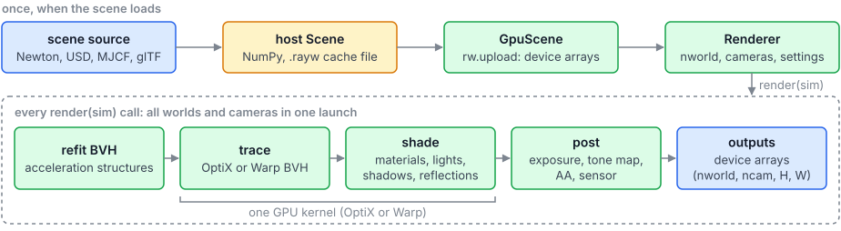
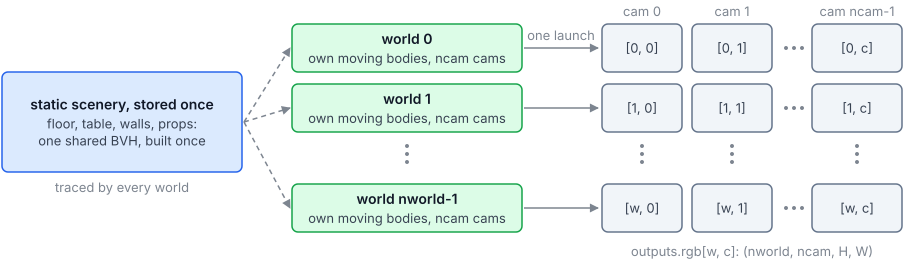
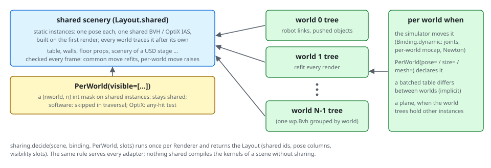
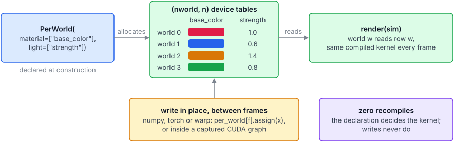

# Concepts

The mental model behind the API: a scene, a renderer, worlds, cameras, settings and per-world
randomisation. Each section is short and links to the page with the details.

## Quick start

The whole model in one snippet. The numbered comments match the sections below.

```python
import newton
import newton.examples
import numpy as np
import warp as wp

import raywarp as rw
import raywarp.integrations.newton

robot = newton.ModelBuilder()
robot.add_usd(newton.examples.get_asset("ant.usda"))  # a USD stage
builder = newton.ModelBuilder()
builder.add_ground_plane()
builder.replicate(robot, 4)
model = builder.finalize()

scene = rw.integrations.newton.scene(model, lighting=rw.Lighting.studio())  # 1. the scene, on the device
r = rw.Renderer(  # 2. the renderer
  scene,
  nworld=4,  # 3. worlds
  cameras=[rw.CameraSpec(fovy=60)],  # 4. cameras
  resolution=(64, 48),
  settings=rw.RenderSettings().replace(rw.FAST),  # 5. settings
  per_world=rw.PerWorld(material=["base_color"]),  # 6. what varies per world
)
r.camera_pose.fill_(wp.transformf((0.0, -3.0, 1.2), wp.quat_from_axis_angle(wp.vec3(1.0, 0.0, 0.0), 1.35)))
color = r.per_world["material.base_color"]  # (nworld, nmaterial) RGBA, one row per world
tint = color.numpy()
tint[..., :3] = np.random.default_rng(0).uniform(0.1, 1.0, tint[..., :3].shape)
color.assign(tint)
out = r.render(model.state())  # every world and camera in one call
assert out.rgb.shape == (4, 1, 48, 64)
```

## Scene

A scene is the geometry, materials, lights, cameras and environment of what you render. It
exists in two forms:

| form | what it is | how you get one |
| --- | --- | --- |
| `rw.Scene` | the host scene: NumPy arrays you can inspect, edit and save as a `.rayw` file | `rw.formats.usd.load(path)`, `rw.formats.gltf.load(path)`, `rw.integrations.newton.load(model)`, `rw.SceneBuilder` |
| `rw.GpuScene` | the device scene the renderer reads | `rw.upload(host)`, or a one-call shortcut |

The one-call shortcuts load and upload together: `rw.integrations.newton.scene(model)`,
`rw.integrations.mujoco.scene(mjm, m)`, `rw.formats.usd.scene(path)`, `rw.formats.gltf.scene(path)`.

Simulator scenes stay connected to the simulator:

- A Newton scene reads the body poses from `state.body_q`. With
  `rw.integrations.newton.load_usd(model, stage)`, it also keeps the USD stage's own materials
  and lights ([quickstart](quickstart.md#newton-with-the-stages-own-materials-and-lights)).
- A MuJoCo Warp scene reads the model's arrays in place, with no copy. Poses come from the
  `mjw.Data` you pass to each render.

Every material becomes an OpenPBR Surface (`rw.Material`), whatever its source format. A loader
reports what it dropped or approximated in `gpu.report`. Details: [scenes](scenes.md).

## Renderer



`rw.Renderer(scene, nworld=..., cameras=..., resolution=..., settings=..., per_world=...)`
renders `nworld` worlds x `ncam` cameras of one scene on every call.

| call | what it does |
| --- | --- |
| `r.render(sim)` | renders the simulator state (a Newton `State`, an `mjw.Data`, or nothing for a static scene) and returns `r.outputs` |
| `r.outputs` | device arrays of shape `(nworld, ncam, H, W)`, the same arrays every frame, written in place |
| `out.torch()` | zero-copy torch views of the outputs |
| `r.capture(step, sim)` | records the simulator step and the render in one CUDA graph |
| `r.update_settings(...)` | changes settings on a live renderer |
| `r.explain()` | prints what the settings mean on this scene and what the frame costs |
| `r.close()` | releases the renderer |

The renderer never copies to the host on its own. A renderer belongs to one scene: a new scene
needs a new renderer ([data generation](datagen.md#reusing-a-renderer-across-scenes)).

## Worlds



A world is one copy of the scene: one environment of a vectorised simulator. All worlds render
in one call.

What does not move and is not randomised is stored once and shared by every world. Only what
differs between worlds gets its own copy. Memory and setup time grow with what varies, not with
the number of worlds.



<!-- SHOWCASE: concepts/worlds.webp (docs/assets/SHOTS.md) -->


`r.render(sim, active=ids)` renders only the listed worlds. The frame time follows their number,
and the other worlds keep their last image ([selected worlds](robotics.md#selected-worlds-only)).

## Cameras

`cameras=` picks the cameras every world renders:

| you write | you get |
| --- | --- |
| `cameras=["front", "wrist"]` | the scene's cameras by name (USD camera prims, MJCF camera names) |
| `cameras=None` | every camera of the scene |
| `cameras=[rw.CameraSpec(fovy=60)]` | a free camera, posed per world through `r.camera_pose` |
| `rw.CameraSpec(mount=..., ...)` | a camera that follows a scene camera, e.g. on a robot's wrist |

`resolution=(width, height)` applies to every camera, unless a `CameraSpec` sets its own.
Projections include pinhole, orthographic, fisheye and OpenCV / Kannala-Brandt distortion
(`rw.CameraSpec.from_opencv(...)`). `r.camera_info()` exports each world's intrinsics and pose in
OpenCV conventions. Details: [cameras](scenes.md#cameras).

## Settings

`rw.RenderSettings` holds every rendering option, in groups (`outputs`, `aa`, `shadows`,
`lighting`, `gi`, `exposure`, `sensor`, ...). Address a field as `"group.field"`:

```python
fast = rw.RenderSettings().replace(rw.FAST)  # maximum training throughput, still PBR
quality = rw.RenderSettings().replace({"aa.spp": 2, "shadows.samples": 2, "shadows.max_casters": 16})
s = rw.RenderSettings().replace({"outputs": rw.Outputs.of("rgb", "depth", "seg"), "exposure.mode": "manual"})
r.update_settings(**{"exposure.ev100": 12.0})  # on a live renderer
```

Three starting points:

| recipe | use it for |
| --- | --- |
| `rw.FAST` | training: point lights, 2 shadow casters, no reflection rays |
| the default, `rw.RenderSettings()` | training that needs reflections and soft lighting, evaluation |
| quality (2 x 2 samples per pixel, soft shadows, more exact lights) | datasets, demos, high-resolution policies |

<!-- SHOWCASE: concepts/recipes.webp (docs/assets/SHOTS.md) -->


Every recipe is deterministic per frame. The other recipes and what each group costs:
[settings](settings.md#recipes).

## Per-world randomisation



Each world can look different. Declare what varies with `rw.PerWorld(...)` when you build the
renderer, as in the quick start. Then write the tables between frames:
`r.per_world["material.base_color"]` is a `(nworld, nmaterial)` device array, and world `w`
reads row `w`.

- Writing a table is data: nothing recompiles, nothing goes back to the host.
- A captured CUDA graph keeps replaying with the new values.
- Materials, textures, lights, the environment, exposure, fog, cameras, lens distortion,
  visibility and prop poses can vary.
- MuJoCo Warp's batched model arrays (`m.geom_rgba`, `m.light_diffuse`, ...) are also read per
  world on every frame.

How to: [domain randomisation](domain_randomisation.md). Every knob for dataset generators:
[dataset generation](randomization.md).

## Kernels and first use

The GPU code is compiled ahead of time for each supported GPU. The first renderer on a machine
downloads only what its settings use, then keeps it on disk. Scenes, setting values and
per-world tables are data, so changing them compiles nothing.

The first frame still prepares the scene once (upload, one-time precomputations).
`rw.Renderer.warm(...)` does that ahead, in the background ([quickstart](quickstart.md#warm-up-before-the-first-frame)).

Rays are traced with OptiX on GPUs with RT cores, and with Raywarp's own BVH on GPUs without
them (A100, H100) and on the CPU. Details: [how the kernels work](performance.md#how-the-kernels-work).

## See also

- [Quickstart](quickstart.md): a first render with each integration.
- [Robotics recipes](robotics.md): torch observations, outputs, CUDA graphs.
- [Domain randomisation](domain_randomisation.md): how to randomise, per simulator.
- [Settings](settings.md) and [performance](performance.md): what each option costs.
