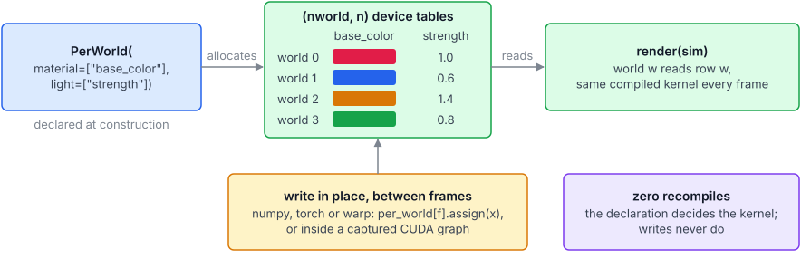

# Domain randomisation

Give every world of a batch its own look: colours, textures, lights, sky, camera, distractors and
sensor noise. You declare once what varies, then write new values every step. Nothing recompiles.

## Quick start

Four worlds of a USD robot in Newton, each with its own colours, roughness and light strength:

```python
import newton
import newton.examples
import numpy as np
import warp as wp

import raywarp as rw
import raywarp.integrations.newton

robot = newton.ModelBuilder()
robot.add_usd(newton.examples.get_asset("ant.usda"))
robot.add_shape_box(-1, xform=wp.transform((0.8, 0.6, 0.1), wp.quat_identity()), hx=0.1, hy=0.1, hz=0.1, color=(0.9, 0.8, 0.1), label="distractor")
builder = newton.ModelBuilder()
builder.add_ground_plane()
builder.replicate(robot, 4)
model = builder.finalize()
state = model.state()
NWORLD = model.world_count
scene = rw.integrations.newton.scene(model, lighting=rw.Lighting.studio())
settings = rw.RenderSettings().replace(rw.FAST)
eye = wp.transformf((0.0, -3.0, 1.2), wp.quat_from_axis_angle(wp.vec3(1.0, 0.0, 0.0), 1.35))

r = rw.Renderer(
  scene,
  nworld=NWORLD,
  cameras=[rw.CameraSpec(fovy=60)],
  resolution=(64, 48),
  settings=settings,
  per_world=rw.PerWorld(material=["base_color", "specular_roughness"], light=["strength"]),  # 1. declare
)
r.camera_pose.fill_(eye)
rng = np.random.default_rng(0)

color = r.per_world["material.base_color"]  # 2. write: (nworld, nmaterial) RGBA
tint = color.numpy()
tint[..., :3] = rng.uniform(0.1, 1.0, tint[..., :3].shape)  # RGB tints; the alpha stays
color.assign(tint)
roughness = r.per_world["material.specular_roughness"]  # (nworld, nmaterial) float
roughness.assign(rng.uniform(0.1, 1.0, roughness.shape).astype(np.float32))
strength = r.per_world["light.strength"]  # (nworld, nlight) float
strength.assign(strength.numpy() * rng.uniform(0.5, 1.5, strength.shape).astype(np.float32))

rgb = r.render(state).rgb.numpy()  # 3. render: each world its own look
```

## How it works



1. **Declare** what varies per world: `rw.PerWorld(...)`, passed to the `Renderer`. Each declared
   field gets a device table of shape `(nworld, n)`, filled with the scene's values.
2. **Write** the tables in place between frames: `r.per_world[field].assign(values)` with a NumPy
   array, a Warp array or a torch tensor (`wp.from_torch`). `r.per_world.columns(field, pattern)`
   picks some instances' columns.
3. **Render**: world `w` reads row `w` of every declared table. Undeclared fields keep one value
   for every world.

<!-- SHOWCASE: domain_randomisation/grid.webp (docs/assets/SHOTS.md) -->
[](assets/domain_randomisation/grid.mp4)

Rules:

| rule | why it matters |
| --- | --- |
| declare once, write forever | the declaration picks the GPU code at construction. Write anything it allows; never redeclare. A few declarations pick extra code: `alpha=True`, `light=["type"]`, `camera=["distortion"]` ([how the kernels work](performance.md#how-the-kernels-work)). |
| declare what varies per world | an undeclared field is one value shared by every world. Writing it changes every world, and the global illumination re-computes a frame later. |
| colours are RGB tints | a declared `base_color` or instance `color` varies RGB only. `alpha=True` varies alpha too, at about +6 % frame time. To hide an object, use `visible`, not alpha 0. |
| instance colour times material colour | an instance colour multiplies its material's colour. MuJoCo keeps its own rule: the default geom rgba (0.5, 0.5, 0.5, 1) shows the material's colour, any other replaces it. |
| patterns | `fnmatch` globs on `scene.instance_names` (MuJoCo geom names, Newton shape labels, USD prim paths) or instance indices. A pattern that matches nothing raises. |
| appearance stays shared | colours, materials, textures, lights, cameras and the environment never copy geometry. Pose, size and mesh fields give the instance one copy per world; `visible` keeps it shared. |
| write device arrays in a training loop | `.assign(warp_array)` copies on the device. `.assign(numpy)` uploads first. Draw values with torch or Warp, or write `wp.to_torch(table)` in place. |
| values are checked | ids are clamped and reported. NaN, infinite or out-of-range floats raise at the next render, naming the field. The check never synchronises. |
| episode resets | with the motion output, call `r.reset_history(mask)` for the re-randomised worlds |

To share one prepared array with a simulator or several renderers, declare the field, then
`r.bind_per_world(field, array)`. The array must match the table's shape, dtype and device.
Rebinding makes captured graphs stale; in-place writes do not.

## What you can declare

| `rw.PerWorld(...)` argument | what varies per world | example fields |
| --- | --- | --- |
| `material=[...]` | material inputs (OpenPBR names), instance colours, texture choice and placement, material assignment | `base_color`, `specular_roughness`, `base_metalness`, `color`, `texture`, `tex_variation`, `instance.material` |
| `light=[...]` | each light's on / off, intensity, colour, position, direction, size, cone, type | `active`, `strength`, `color`, `pos`, `dir`, `radius`, `type` |
| `env=[...]` | environment map, its rotation and intensity, exposure, ambient, fog, colour grading, sensor | `id`, `yaw`, `intensity`, `exposure`, `fog.color`, `grading.*`, `sensor.noise` |
| `camera=[...]` | field of view, intrinsics, lens distortion | `fovy`, `intrinsics`, `distortion` |
| `visible=[patterns]` | whether an instance is shown | `"distractor_*"` |
| `pose=`, `size=`, `mesh=` `[patterns]` | pose, primitive size or mesh of a static instance | `"crate*"` |
| `dynamic_lights=[i, ...]` | a hint: lights that move every step (direct light only) | `[0, 7]` |

Every field, its granularity and its cost: [dataset generation: every knob](randomization.md).

## Cookbook

Short recipes, each one step of a training loop. They share one renderer over the Newton scene
above that declares every table they write:

```python
ck = rw.Renderer(
  scene,
  nworld=NWORLD,
  cameras=[rw.CameraSpec(fovy=60)],
  resolution=(64, 48),
  settings=settings.replace(**{"sensor.noise": True}),  # the noise switch; its level is per world
  per_world=rw.PerWorld(
    material=["base_color", "specular_roughness", "base_metalness"],
    light=["active", "strength", "color"],
    visible=["distractor"],
    camera=["fovy"],
    env=["exposure", "sensor.noise"],
  ),
)
home = np.array([0.0, -3.0, 1.2, 0.625, 0.0, 0.0, 0.781], np.float32)  # position, quaternion (x, y, z, w)
ck.camera_pose.assign(np.tile(home, (NWORLD, 1, 1)))
```

### Randomise materials per world

Colours are RGB tints that keep each material's alpha. Roughness and metalness are plain floats
per world and material:

```python
color = ck.per_world["material.base_color"]
tint = color.numpy()
tint[..., :3] = rng.uniform(0.05, 0.95, tint[..., :3].shape)
color.assign(tint)
for field, low, high in (("material.specular_roughness", 0.1, 1.0), ("material.base_metalness", 0.0, 0.3)):
  table = ck.per_world[field]
  table.assign(rng.uniform(low, high, table.shape).astype(np.float32))
```

<!-- SHOWCASE: domain_randomisation/materials.webp (docs/assets/SHOTS.md) -->


Textures: declare `material=["tex_variation"]` and write UV offset, rotation and hue with
`rw.randomize.jitter`. No texture is copied ([MuJoCo example](#mujoco-and-mujoco-warp)).

### Randomise lights: count, intensity, colour

The scene holds every light a world may use. `active` switches them, so the light count varies
per world:

```python
nlight = ck.per_world["light.active"].shape[1]
on = rng.random((NWORLD, nlight)) < 0.7
on[np.arange(NWORLD), rng.integers(0, nlight, NWORLD)] = True  # at least one light per world
ck.per_world["light.active"].assign(on)
strength = ck.per_world["light.strength"]
strength.assign(strength.numpy() * rng.uniform(0.5, 2.0, strength.shape).astype(np.float32))
ck.per_world["light.color"].assign(rng.uniform(0.7, 1.0, (NWORLD, nlight, 3)).astype(np.float32))
```

<!-- SHOWCASE: domain_randomisation/lights.webp (docs/assets/SHOTS.md) -->


### Randomise exposure and sensor noise

Exposure is a per-world factor. The noise rows are (full well, read noise) in electrons:

```python
exposure = ck.per_world["exposure"]
exposure.assign(exposure.numpy() * rng.uniform(0.7, 1.4, exposure.shape).astype(np.float32))
noise = ck.per_world["sensor.noise"]
noise.assign(noise.numpy() * rng.uniform(0.5, 2.0, (NWORLD, 1)).astype(np.float32))
```

For a different sky per world, give the scene several environment maps
(`lighting=rw.Lighting(envmap=[a, b, c])`), declare `env=["id", "yaw"]` and write
`r.per_world["env.id"]`. `rw.scene.sun_sky(elevation, azimuth)` makes a clear sky with a sun.

<!-- SHOWCASE: domain_randomisation/environment.webp (docs/assets/SHOTS.md) -->


### Jitter the camera

Free cameras are posed by `camera_pose`, with no declaration. The field of view is a declared
table:

```python
pose = np.tile(home, (NWORLD, 1, 1))
pose[..., :3] += rng.normal(0.0, 0.03, (NWORLD, 1, 3)).astype(np.float32)  # a few centimetres
ck.camera_pose.assign(pose)
fovy = ck.per_world["camera.fovy"]
fovy.assign(rng.uniform(50.0, 70.0, fovy.shape).astype(np.float32))
```

<!-- SHOWCASE: domain_randomisation/camera.webp (docs/assets/SHOTS.md) -->


### Show and hide distractors

Show or hide a pool of props per world. Hidden props stay shared by every world, so this is
free:

```python
shown = ck.per_world.columns("instance.visible", "distractor")  # (nworld, 1) int: 0 hides
shown.assign(rng.integers(0, 2, shown.shape).astype(np.int32))
rgb = ck.render(state).rgb.numpy()  # every recipe above, in one frame
```

### Re-randomise on episode reset

Re-randomise only the worlds that reset. With the motion output, also restart their history:

```python
done = rng.random(NWORLD) < 0.5
tint = color.numpy()
tint[done, :, :3] = rng.uniform(0.05, 0.95, tint[done, :, :3].shape)
color.assign(tint)
ck.reset_history(wp.array(done, dtype=bool))
```

### Write the tables from torch

In a training loop, draw the values where the policy runs. A table is a Warp array, so torch
writes it in place, with no host copy, inside a captured graph too:

```python
# docs: requires torch
import torch

roughness = wp.to_torch(ck.per_world["material.specular_roughness"])
roughness.uniform_(0.1, 1.0)  # in place: the next render reads it
```

## Per simulator

### Newton

Build the Renderer over `rw.integrations.newton.scene(model)` (or a `load_usd` scene) with a
`PerWorld`, as in the cookbook.

- Shapes whose `model.shape_color` differs between worlds show each world's colour, re-read on
  every render. For any other shape, declare `material=["color"]` and write
  `r.per_world["instance.color"]`.
- Newton poses every shape, static ones too. Move them through the model, not with
  `PerWorld(pose=...)`.
- Worlds may hold different shapes: each world shows its own, with no recompile.
- The `SensorCamera` and viewer drop-ins make their own renderer, without per-world tables.

### MuJoCo and MuJoCo Warp

`rw.integrations.mujoco.scene(mjm, m, d)` reads the model's arrays in place. Batch a model array
(one row per world) and the renderer reads it per world on every frame, as MuJoCo Warp's own
renderer does:

| model array | renders as |
| --- | --- |
| `geom_rgba`, `geom_matid`, `geom_size`, `geom_dataid` | instance colour, material, size, mesh |
| `mat_rgba`, `mat_emission`, `mat_specular`, `mat_texid`, `mat_texrepeat`, `mat_texuniform` | material colour, emission, reflectance, textures |
| `light_type`, `light_active`, `light_diffuse`, `light_castshadow`, `light_cutoff` | the lights |
| `mat_shininess` (batched before the Renderer is created) | roughness = 1 - shininess, where the material sets no roughness |
| `cam_fovy`, `cam_intrinsic` | the scene cameras' field of view and intrinsics |
| `light_pos` / `light_dir`, `cam_pos` / `cam_quat`, `body_*`, `geom_pos` / `geom_quat` | poses, through `mjw.forward` |

```python
import mujoco
import mujoco_warp as mjw

import raywarp.integrations.mujoco

XML = """
<mujoco>
  <asset>
    <texture name="wood" type="2d" builtin="checker" rgb1="0.6 0.4 0.2" rgb2="0.3 0.2 0.1" width="32" height="32"/>
    <material name="table" texture="wood" texrepeat="4 4"/>
  </asset>
  <worldbody>
    <light name="key" pos="0.5 -0.5 2" dir="-0.2 0.2 -1"/>
    <geom name="table" type="box" size="0.6 0.4 0.02" pos="0 0 0.5" material="table"/>
    <geom name="distractor" type="sphere" size="0.05" pos="0.2 0.2 0.57" rgba="0.9 0.9 0.1 1"/>
    <camera name="cam" pos="0 -1.0 1.1" xyaxes="1 0 0 0 0.6 0.8" fovy="50"/>
  </worldbody>
</mujoco>
"""
mjm = mujoco.MjModel.from_xml_string(XML)
m = mjw.put_model(mjm)
m.geom_rgba = wp.array(np.repeat(m.geom_rgba.numpy()[:1], NWORLD, axis=0), dtype=wp.vec4)  # batched: one row per world
m.cam_fovy = wp.array(np.repeat(m.cam_fovy.numpy()[:1], NWORLD, axis=0), dtype=float)
d = mjw.make_data(mjm, nworld=NWORLD)
mj = rw.Renderer(
  rw.integrations.mujoco.scene(mjm, m, d),
  nworld=NWORLD,
  cameras=["cam"],
  resolution=(32, 24),
  settings=settings,
  per_world=rw.PerWorld(material=["tex_variation"]),
)
rgba = m.geom_rgba.numpy()
rgba[:, mjm.geom("distractor").id, :3] = rng.uniform(0.1, 1.0, (NWORLD, 3))
m.geom_rgba.assign(rgba)  # in place, every step if you like
m.cam_fovy.assign(rng.uniform(40.0, 60.0, (NWORLD, 1)).astype(np.float32))
texture = mj.per_world["material.tex_variation"]  # (nworld, nmaterial) vec4: u, v offset, UV rotation, hue
texture.assign(rw.randomize.jitter(texture.numpy(), rng, uv_offset=1.0, uv_rotation=np.pi, hue=0.3))
mjw.forward(m, d)
rgb = mj.render(d).rgb.numpy()
```

- A declared per-world field wins over the model array of the same quantity.
- `cam_projection`, `cam_sensorsize` and `light_exponent` keep their values at scene creation.
  A batched one warns and names the per-world field to declare instead.
- MuJoCo lights follow `d.light_xpos` / `d.light_xdir`: move them through `m.light_pos` /
  `m.light_dir`, not `light=["pos"]`.
- Static geoms posed per world: declare `PerWorld(pose=[...])`, then write their
  `d.geom_xpos` / `d.geom_xmat` per world.
- Mocap bodies posed alike in every world (a table mjlab wraps in a mocap body) are shared
  scenery. Moving them raises with the fix: `PerWorld(pose=["table/*"])`.
- The MuJoCo Warp drop-in (`create_render_context`) reads the same arrays; `rc.renderer.per_world`
  gives the rest.

### mjlab

mjlab's events randomise the model arrays above (`sim.expand_model_fields`, then writes per
environment). They reach Raywarp's sensors as they reach MuJoCo Warp's renderer. Declare with
`RaywarpCameraSensorCfg(raywarp_per_world=rw.PerWorld(...))`:

- the mocap entities that reset events move per world;
- any table mjlab has no model field for: textures, environment maps, exposure, sensor noise.

### Isaac Lab

Isaac's visual-material events (`randomize_visual_color` and the scalar channels) are written per
environment on the device: colour, roughness, metallic and OmniPBR specular level. They never
recompile. Other material inputs (emission, opacity, UV placement, IOR, texture swaps) and light
or dome randomisation are reported, not applied.

### USD stages and hand-built scenes

Host scenes (`rw.formats.usd.scene`, `rw.SceneBuilder`) accept every `PerWorld` field, including
light positions and static prop poses:

```python
b = rw.SceneBuilder()
wall = b.add_material(rw.Material(base_color=(0.8, 0.8, 0.8), specular_roughness=0.9))
b.add_instance("box", material=wall, size=(2.0, 0.05, 1.2), xform=np.c_[np.eye(3), [0.0, 2.0, 1.2]], path="wall")
b.add_instance("box", material=wall, size=(0.3, 0.3, 0.3), xform=np.c_[np.eye(3), [0.3, 0.5, 0.3]], path="crate")
b.add_light(rw.Light.point((0.0, 0.0, 2.2), intensity=80.0, radius=0.05))
b.add_light(rw.Light.point((1.2, 1.2, 1.5), intensity=40.0, radius=0.05))
room = rw.Renderer(
  rw.upload(b.build()),
  nworld=NWORLD,
  cameras=[rw.CameraSpec(fovy=70.0)],
  resolution=(32, 24),
  settings=settings,
  per_world=rw.PerWorld(material=["base_color"], light=["active", "color", "pos"], pose=["crate"]),
)
room.camera_pose.assign(np.tile(np.array([0.0, -1.9, 1.3, 0.45, 0.0, 0.0, 0.893], np.float32), (NWORLD, 1, 1)))
active = np.ones((NWORLD, 2), bool)
active[:, 1] = rng.integers(0, 2, NWORLD).astype(bool)  # the second lamp on or off
room.per_world["light.active"].assign(active)
lamps = room.per_world["light.pos"]
lamps.assign(lamps.numpy() + rng.uniform(-0.5, 0.5, (*lamps.shape, 3)).astype(np.float32))
crate = room.per_world.columns("instance.pos", "crate")  # (nworld, 1) positions
crate.assign(crate.numpy() + rng.uniform(-0.3, 0.3, (NWORLD, 1, 3)).astype(np.float32))
rgb = room.render().rgb.numpy()
```

A posed prop leaves the shared scenery: each world gets its own copy, refit every frame.

## GI under randomisation

The global illumination (GI) follows each world's own lights and materials. Raywarp compares the
worlds on the device and groups them:

| worlds | what the GI does |
| --- | --- |
| all equal | one volume, as without randomisation |
| a few variants (at most half the worlds distinct) | one exact volume per variant |
| continuous randomisation | one shared volume, tinted per world |

What each change costs once the GI is tinted per world (`r.debug.gi_rebakes()` lists every
re-computation and its reason):

| change | GI work | cost |
| --- | --- | --- |
| first render | computes the GI (cached on disk, so a warm start loads it) | up to ~1 s cold (Office 0.68 s, RTX PRO 6000) |
| robot links, posed props, cameras, exposure | nothing: the GI sees the static scenery only | 0 |
| a light's colour, intensity or on / off; the environment intensity | recombined without rays | a few multiply-adds per cell |
| a world's materials, environment map or yaw; a light moved over half a probe spacing | that world re-lit by rays | ~65k rays per world |
| a one-value table written in place (shared by every world) | full re-computation, a frame later | one bake; declare the field per world instead |
| a light declared in `dynamic_lights` | nothing: direct light and shadows only | 0 |

- **Lights that move** (a lamp on a robot, a flashlight): declare them
  `PerWorld(dynamic_lights=[i, ...])`. Raywarp warns at the first render about a MuJoCo light on
  a moving body that is not declared.
- **The first frame after new variants appear shows the previous GI.** Randomise before the first
  render, or render once more after the first randomisation, to avoid it.
- **Re-light once per episode**, not every frame: `gi.relight="on_request"`, then
  `r.request_gi_relight(mask)` at reset ([dataset generation](randomization.md#gi-under-randomisation-per-frame-or-per-episode)).
- Moving objects receive indirect light but cast no indirect shadows of their own.
- A per-world emission on an emissive panel changes the visible surface, not its light or the GI.
- Open outdoor scenes: turn the GI off (`gi={"enabled": False}`).

> **New in 0.4.0:** colour, intensity and on / off changes are recombined without rays, and
> `gi.relight="on_request"` with `r.request_gi_relight(...)`.

## What it costs

| | cost |
| --- | --- |
| a declared appearance table | `nworld x n x element` bytes, read where the shared value was read |
| writing 11 tabletop tables from device arrays | about 1 ms on the CPU (32 x 24 px, 4 worlds), no allocation, no host round trip |
| validation | one tiny kernel per declared float table |
| GI | rays only for materials, environment map or yaw, and moved lights |
| per-world geometry (pose, size, mesh) | one copy and one refit per world |
| every table at once, 4096 worlds | +10-13 % frame time on an RTX PRO 6000, +2-5 % on an L4 |

## Recipes from the literature

| recipe | what it randomises | here |
| --- | --- | --- |
| Tobin et al. 2017 (object detection, sim-to-real) | textures, distractor count and shape, lights, camera pose and fov, noise | `base_color`, `texture` over a texture bank, `tex_variation`, `visible` + `pose` distractor pools, `light` tables (`active` for the count), `camera_pose` / `fovy`, `sensor.noise` |
| OpenAI 2018-2019 (dexterous hand, Rubik's cube) | colours, textures, materials, lights, camera pose and intrinsics, blur, colour, noise | the material, light and camera tables, `grading.*`, `sensor.*`; blur is per renderer (`sensor.motion_blur`) |
| Isaac Lab (replicator events) | visual colour, texture from a list, dome / light intensity and colour, camera | colour and scalar channels through the adapter; textures and lights: declare and write the tables directly |
| MuJoCo Playground / mjlab | `geom_rgba`, `mat_rgba`, light diffuse / position, camera pose / fovy | read per world from the batched model ([MuJoCo](#mujoco-and-mujoco-warp)) |

## Known gaps

- New textures, meshes or lights at run time. A scene holds a fixed bank: swap among them per
  world, and add every light a world may need.
- Per-world non-uniform mesh scale. A uniform scale is pose data (write `instance.rot` as s R);
  a non-uniform one is a different mesh: author it, or swap meshes with `mesh=[...]`.
- Glass per world is slower: switching a see-through material per world gives every instance its
  own copy per world. Choosing among opaque materials keeps full sharing.
- Per-world environment tint (use `grading.white_balance`), resolution and shadow settings.
- Newton `shape_color` written after load for shapes that had one colour in every world, and
  Isaac Lab texture, light or dome events: declare the matching `PerWorld` field instead.
- Image-space augmentations (JPEG artefacts, random erasing, crops) belong in the training code.

## See also

- [Dataset generation: every knob and ground truth](randomization.md): every field, its
  granularity, and the ground-truth outputs.
- [Robotics recipes](robotics.md): torch, outputs, CUDA graphs.
- [Concepts: per-world randomisation](concepts.md#per-world-randomisation).
