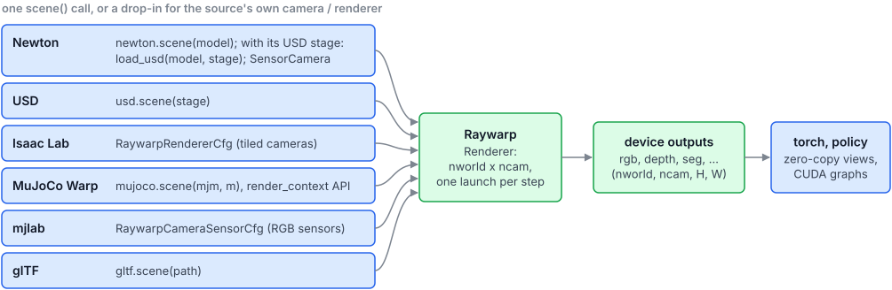

# Features

A short tour of what Raywarp does, with pictures. Each section links to the page with the details.



## Quick start

Four worlds of a USD robot simulated by Newton, rendered in one call:

```python
import newton
import newton.examples
import warp as wp

import raywarp as rw
import raywarp.integrations.newton

robot = newton.ModelBuilder()
robot.add_usd(newton.examples.get_asset("ant.usda"))  # any USD stage
builder = newton.ModelBuilder()
builder.add_ground_plane()
builder.replicate(robot, 4)
model = builder.finalize()
scene = rw.integrations.newton.scene(model, lighting=rw.Lighting.studio())
r = rw.Renderer(scene, nworld=4, cameras=[rw.CameraSpec(fovy=60)], resolution=(64, 48))
r.camera_pose.fill_(wp.transformf((0.0, -3.0, 1.2), wp.quat_from_axis_angle(wp.vec3(1.0, 0.0, 0.0), 1.35)))
out = r.render(model.state())
assert out.rgb.shape == (4, 1, 48, 64)  # (worlds, cameras, height, width)
```

MuJoCo Warp, mjlab, Isaac Lab and plain USD / glTF files have a snippet like this one in the
[quickstart](quickstart.md).

## Why Raywarp

- **Batched.** One call renders every world and camera. Static scenery is stored once for all
  worlds. Only what moves or is randomised gets a copy per world.
- **Fast.** OptiX on GPUs with RT cores, Raywarp's own BVH elsewhere. The simulator step and the
  render fit in one CUDA graph. Nothing goes back to the host per frame.
- **Physically based.** One material model, OpenPBR Surface, for every source: MJCF,
  UsdPreviewSurface, MDL, MaterialX and glTF. Area lights, soft shadows, environment lighting,
  glossy reflections, glass and global illumination, with real light units and auto exposure.
- **Randomise without recompiling.** Materials, textures, lights, sky, exposure, cameras and
  visibility vary per world. Changing a value, a scene or a settings recipe compiles nothing.
- **Prebuilt kernels.** The GPU code ships compiled for each GPU generation. A new machine
  downloads what it needs instead of compiling for minutes
  ([how the kernels work](performance.md#how-the-kernels-work)).

## One call, many worlds

Every world and camera of a batch renders together, into `(nworld, ncam, H, W)` arrays.
`r.render(d, active=ids)` renders only the listed worlds, and the frame time follows their number
([selected worlds](robotics.md#selected-worlds-only)).

<!-- SHOWCASE: features/batch_mosaic.webp (docs/assets/SHOTS.md) -->
[](assets/features/batch_mosaic.mp4)

## Outputs

Ask for any combination in one call: rgb, depth, instance and semantic segmentation, normals,
albedo, HDR radiance, position, UV, material id, roughness, metallic, direct and indirect light,
motion vectors, NOCS, point clouds and camera parameters. Channels-first and float16 layouts for
training are written directly by the renderer
([outputs](robotics.md#outputs-what-you-can-request-and-what-it-costs),
[ground truth](randomization.md#ground-truth)).

<!-- SHOWCASE: features/outputs.webp (docs/assets/SHOTS.md) -->


## Per-world randomisation

Materials, textures, lights, environment maps, exposure, fog, cameras, lens distortion, visibility
and prop poses vary per world. Nothing recompiles, and a captured CUDA graph keeps replaying
([domain randomisation](domain_randomisation.md)).

<!-- SHOWCASE: features/randomisation.webp (docs/assets/SHOTS.md) -->


## Cameras, lenses, sensors

Pinhole, orthographic and fisheye cameras, OpenCV and Kannala-Brandt distortion, per-pixel rays,
and cameras mounted on a robot ([cameras](scenes.md#cameras)). Sensor noise, vignette, camera
response, rolling shutter, motion blur and stereo depth make images look like a real camera's
([sensor effects](robotics.md#sensor-effects-noise-vignette-response-stereo-depth-rolling-shutter-motion-blur)).

## Lighting and materials

Point, spot, area, sun and IES lights, HDR environment maps, global illumination and fog
([scenes](scenes.md)). Textures, clear coat, refracting glass and translucent layers
([materials](scenes.md#materials-and-textures)). Anti-aliasing by supersampling or FXAA. Every
frame is deterministic: there is no accumulation over frames ([settings](settings.md)).

## Recording and tools

MP4 files of one view or a whole batch, encoded on the GPU at render speed
([recording](recording.md)). A web viewer (`raywarp view`) and commands to record, convert and
manage kernels ([command line](cli.md)).

## See also

- [Demo gallery](gallery.md): looping clips of runnable demos.
- [Quickstart](quickstart.md): a first render with each integration.
- [Concepts](concepts.md): the model behind the API.
