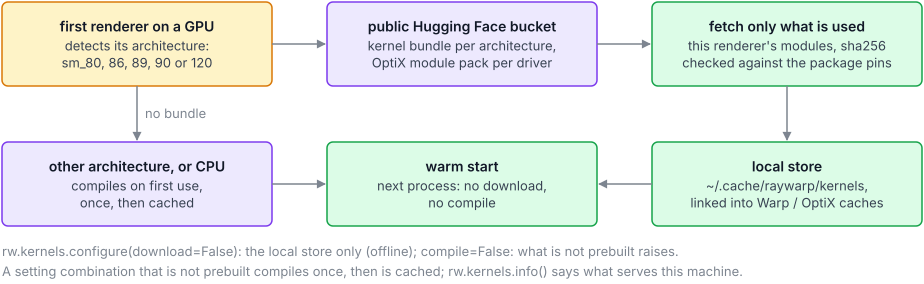

# Install

Install raywarp with the extras of your simulator or scene format, then check the machine.

## Quick start

```bash
pip install "raywarp[newton,usd]"   # Python >= 3.12; Newton models and USD stages
raywarp info                        # GPU, driver, OptiX, Warp and the kernel download
```

`raywarp info` ([CLI](cli.md)) shows the GPU, its compute capability and RT cores, the driver,
OptiX, Warp, the traversal `"auto"` picks, and whether the kernel download answers.

## Extras

| command | adds |
| --- | --- |
| `pip install raywarp` | the core (warp-lang 1.18 and numpy) |
| `pip install "raywarp[newton]"` | Newton scenes and the `SensorCamera` drop-in |
| `pip install "raywarp[usd]"` | USD stages (usd-core, pillow, materialx, openexr) |
| `pip install "raywarp[mujoco]"` | MuJoCo Warp scenes (and mjlab) |
| `pip install "raywarp[gltf]"` | glTF scenes (the usd extra and pygltflib) |
| `pip install "raywarp[viewer]"` | the web viewer's image encoding (pillow) |
| `pip install "raywarp[video]"` | NVENC recording from device memory (PyNvVideoCodec; Linux, Windows) |
| `pip install "raywarp[all]"` | all of the above |

The wheel bundles the OptiX SDK headers and the MDL SDK. It is one `cp312-abi3` wheel per
platform. Recording also needs the `ffmpeg` CLI on `PATH` ([recording](recording.md)). The GPU
kernels are not in the wheel: they download on first use ([below](#prebuilt-kernels)).

## Supported GPUs

Any NVIDIA GPU with a driver serving OptiX 9.0 (R580 or newer) runs the RT-core path. These
architectures have prebuilt kernels; others compile their kernels once on first use.

| architecture | GPUs | traversal |
| --- | --- | --- |
| sm_80 | A100 | Warp BVH (no RT cores) |
| sm_86 | A10, A40, RTX 30 | OptiX (RT cores) |
| sm_89 | L4, L40S, RTX 40 | OptiX (RT cores) |
| sm_90 | H100 | Warp BVH (no RT cores) |
| sm_120 | RTX PRO 6000 Blackwell, RTX 50 | OptiX (RT cores) |

`performance.traversal="auto"` (the default) picks OptiX on GPUs with RT cores. It picks the Warp
BVH elsewhere, CPU included. Both paths have the same features. There is no silent fallback: where
OptiX cannot run on an RT-core GPU, the renderer raises and names the cause
([OptiX](performance.md#optix)). OptiX comes with the driver, so there is nothing else to install.

## Prebuilt kernels



You never compile the renderer. The kernels are compiled ahead, one bundle per GPU architecture,
plus a pack of ready OptiX modules per NVIDIA driver release
([how the kernels work](performance.md#how-the-kernels-work)).

On first use, the renderer:

1. detects the GPU's architecture;
2. downloads only what it uses (megabytes for a scene's first frame) from the public Hugging Face
   bucket `blanchon/raywarp-kernels`;
3. checks each file against the hashes pinned in the installed package;
4. keeps it in a local store: `$RAYWARP_KERNELS`, default `~/.cache/raywarp/kernels`.

Later runs read the store. Another architecture, or the CPU, compiles its kernels once on first
use, then caches them. A file that cannot be fetched warns once and compiles instead.

> **New in 0.4.0:** `rw.kernels.configure` and its environment variables.

### Forbid downloads or compiles

Two switches control this, for the process (`None` keeps the current value) or by environment
variable (`1` / `0`, both on by default):

```python
import raywarp as rw

rw.kernels.configure(download=False)  # RAYWARP_KERNELS_DOWNLOAD=0: never fetch, the local store only
rw.kernels.configure(compile=False)  # RAYWARP_KERNELS_COMPILE=0: what is not prebuilt raises
print(rw.kernels.current())
rw.kernels.configure(download=True, compile=True)
```

| switch off | effect |
| --- | --- |
| download | Nothing is fetched. The local store is read as it is; what it lacks compiles (or raises, with compile off). |
| compile | A configuration that is not prebuilt raises `rw.kernels.KernelsNotPrebuilt` instead of compiling. The error names it, lists the settings that leave the nearest prebuilt build, and says how to get its kernels. Use it for a fleet of training jobs. |

What is not prebuilt: settings outside the prebuilt builds, `performance.kernels="scene"`, the CPU
device, and the short list in [Zero compiles](performance.md#zero-compiles).

### Run offline or mirror the kernels

Fill a store on a machine with network, copy it, and turn downloads off:

```python
# docs: skip (downloads the bundle of an architecture)
rw.kernels.fetch(120)  # the SM version (120: RTX PRO 6000 / RTX 50); no GPU needed
# then copy $RAYWARP_KERNELS (default ~/.cache/raywarp/kernels) to the offline machine, and there:
rw.kernels.configure(download=False)  # or RAYWARP_KERNELS_DOWNLOAD=0
```

The shell form is `raywarp kernels fetch --arch 120`.

| tool | what |
| --- | --- |
| `rw.kernels.info()` / `raywarp kernels info` | what serves this machine: architecture, pinned bundle, local store, remote, driver, switches |
| `RAYWARP_KERNELS_URL` | a mirror of the remote (`file://` works) |
| `HF_TOKEN` | raises the bucket's rate limit |

## CPU

Every feature runs unchanged on Warp's CPU device (`wp.ScopedDevice("cpu")`). Images are within a
few 1/255 of the GPU's. It is meant for debugging and tests, not throughput
([performance](performance.md#running-on-the-cpu)).

## From source

```bash
git clone https://github.com/julien-blanchon/raywarp && cd raywarp
uv sync --all-extras                # the native build hook fetches the pinned OptiX headers and MDL SDK
```

## See also

- [Quickstart](quickstart.md): the first render
- [Performance and kernels](performance.md): first frames, warm starts, caches
- [Command line](cli.md): `raywarp info`, `raywarp kernels`
- [Developer guide](DEVELOPMENT.md): the layout, the tests, adding a feature
