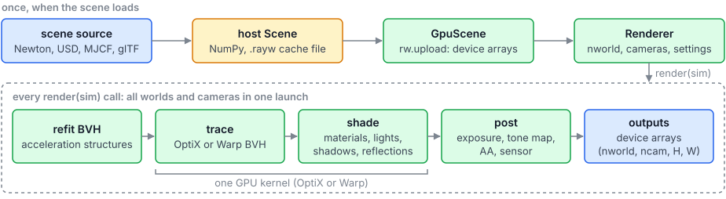

# Performance and kernels

How to make frames fast, how to make the first frame fast, and what (rarely) compiles. This page
also explains, once, the few kernel terms the other pages use.

## Quick start

Warm the run's configurations ahead, then render with the cheapest settings the policy needs:

```python
import mujoco
import mujoco_warp as mjw
import warp as wp

import raywarp as rw
import raywarp.integrations.mujoco

mjm = mujoco.MjModel.from_xml_string("""
<mujoco><worldbody>
  <light pos="0 0 2" dir="0 0 -1"/>
  <geom type="plane" size="2 2 0.1"/><geom type="box" pos="0 0 0.2" size="0.2 0.2 0.2"/>
  <camera name="cam" pos="0 -2 1" xyaxes="1 0 0 0 0.45 0.9"/>
</worldbody></mujoco>""")
m = mjw.put_model(mjm)
d = mjw.make_data(mjm, nworld=4)
mjw.forward(m, d)
scene = rw.integrations.mujoco.scene(mjm, m)
# Every configuration the run will use, warmed together.
warms = [
  rw.Renderer.warm(scene, nworld=4, resolution=(64, 64), settings=s, sim=d)
  for s in (rw.RenderSettings().replace(rw.FAST), rw.RenderSettings())
]
for w in warms:
  print(w.result())  # e.g. "warm 3.20 s: renderer 2.90 s (+2 cached, OptiX 2 compiled / 0 cached), frame 0.30 s (+3 cached)"
r = rw.Renderer(scene, nworld=4, resolution=(64, 64), settings=rw.RenderSettings().replace(rw.FAST))  # starts warm
r.render(d)  # one warm-up frame
wp.synchronize_device()
```

## How the kernels work



A frame is one `render` call. It traces and shades every (world, camera, pixel) of the batch, then
writes the outputs. The call may run several GPU launches (preparation, tracing, display).

These are the only kernel terms the docs use:

| term | what it means for you |
| --- | --- |
| **kernels** | The GPU programs that render. They are compiled ahead, not on your machine. |
| **prebuilt kernels** | One bundle per GPU architecture (sm_80, 86, 89, 90, 120). The first renderer downloads the part it uses, then reads it from disk ([install](install.md#prebuilt-kernels)). |
| **kernel build** | One compiled version of the kernels. A few builds cover every setting. |
| **settings family** | The settings that share one build: the default, `FAST` and unlit shading, each with a few variants. `Renderer.explain()` calls them *tiers* (`kernels: tier 'default'`). |
| **run-time setting** | A number or choice read every frame. Changing it never compiles. |
| **compiled-in setting** | A setting that picks the build. Every documented value lands on a prebuilt build. |
| **run-time switch** | An effect compiled into every build and turned on or off per frame (shadows, reflections, textures, ...). The settings table calls it a "tier switch". |
| **output selection** | Every build can write every output. Each frame picks the requested ones, so new outputs never compile. The settings table calls it "output word". |
| **OptiX modules** | On RT-core GPUs the NVIDIA driver turns a build into OptiX modules. Creating one takes seconds, once per machine and driver; they are cached. Per-driver packs of ready modules download with the kernels. |
| **first use** | A configuration outside the prebuilt builds compiles once (minutes), then is cached on disk. The short list: [Zero compiles](#zero-compiles). |
| **warm** | Doing a configuration's first-frame work ahead (`Renderer.warm`), so the first real frame starts at once. |

`Renderer.explain()` prints which build serves a configuration and why each feature is on or off.
For example `kernels: tier 'default', switched off at run time: gi`. Outside every family it says
`kernels: own (outside the tiers; nearest 'default' differs in budget)`.

## Max-speed checklist

1. **Put everything in one renderer.** A launch renders `nworld x ncam x H x W` pixels.
   Throughput saturates from about 1-4 M pixels per launch (e.g. 256 worlds at 64^2). Below that,
   launch overhead dominates.
2. **Render at the policy's resolution.** Once the GPU is full, pixels cost linearly. A 64^2
   observation is 16x cheaper than 256^2 resized down.
3. **Pick the cheapest settings that show what the policy needs.** In order: geometry-only
   `Outputs` (depth / seg), the unlit recipe, `rw.FAST`, the default
   ([settings](settings.md#fast-field-set)). Turn off what the task does not see:
   `reflections.enabled` (-29 % on Office), `shadows.enabled`, `transparency.enabled`.
4. **Use OptiX on RT-core GPUs.** `performance.traversal="auto"` (the default) does. On an L4 at
   512 worlds x 512^2 it is 3-7x faster on mesh scenes and 1.7-1.9x on primitive-only scenes.
5. **Let CUDA graphs work.** On a CUDA device, `r.render(sim)` records the frame as a CUDA graph on
   the second frame whose inputs repeat. It replays it afterwards. In-place writes keep the graph:
   simulator state, `camera_pose`, per-world tables, integer seeds. Anything else runs one eager
   frame and records again. Graphs matter most at small batch (viewers, video, data generation).
   To fuse the simulator step too: `graph = r.capture(lambda: mjw.step(m, d), sim=d)`, then
   `graph.launch(d)` every step ([robotics](robotics.md#step-and-render-in-one-cuda-graph)).
6. **Render only the worlds you need.** `r.render(d, active=ids)` takes a `(k,)` int32 device
   array of world ids (`-1`: skip the slot). The frame time follows the listed worlds; the others
   keep their last outputs ([robotics](robotics.md#selected-worlds-only)).
7. **Write straight into the policy's tensor.** `rw.settings.ColorOutput(channels=3, planar=True)`
   writes `(nworld * ncam, 3, H, W)` channels-first (uint8, or `dtype="float16"`).
   `r.bind_outputs(rgb=tensor_as_warp_array)` renders into your buffer. Cost on an RTX PRO 6000:
   -0.3 to +1.9 % frame time.
8. **Never read back per frame.** Use `out.torch()` / `wp.to_torch` views, not `.numpy()`. For
   video, encode from device memory ([recording](recording.md)).
9. **Share static scenery.** Instances the simulator never moves are traced once for every world
   (`r.layout` says what is shared). Per-world colors keep the sharing; per-world poses, sizes or
   meshes take an instance out of it ([robotics](robotics.md)).
10. **Identical images.** `performance.render_order="world"` is faster when every world renders
    nearly the same image (fixed cameras on mostly static scenes).
11. **Warm up before training** ([below](#first-frame-prebuilt-kernels-caches-and-warm)).
12. **Big scenes:** bake the `.rayw` once (`rw.formats.usd.bake`) and keep it on a local disk.

## OptiX

OptiX traces on the RT cores. It needs an NVIDIA driver serving OptiX 9.0 (R580 or newer).
OptiX ships in the driver and raywarp bundles the headers, so there is nothing to install.

- `performance.traversal="auto"` picks OptiX on GPUs with RT cores. It picks the software BVH on
  the CPU, on A100 / H100, and for scenes with 1-D flex (segments).
- Both paths render the same pixels (within a few edge pixels) with the same features.
- There is no silent fallback. `"optix"` raises where OptiX cannot run or trace the scene. So does
  `"auto"` on an RT-core GPU whose driver lacks OptiX 9.0. `"software"` forces the Warp BVH.
- Height fields, SDFs and flex surfaces are OptiX triangle structures, refitted as they change.
- A register cap per settings family trades occupancy for spills (128 for the default, 96 for
  `FAST`). The Office is 2.3x faster at 128 than at 64; light scenes are 10-22 % faster at 64.

<!-- SHOWCASE: performance/traversal.webp (docs/assets/SHOTS.md) -->


## First frame: prebuilt kernels, caches and warm

A configuration's first frame does work that later frames skip:

1. fetch its prebuilt kernels (megabytes) and load them;
2. create the OptiX modules it uses, unless the driver's module pack has them;
3. upload the scene (textures are converted once, then cached);
4. run the bakes: light grid, GI probes, environment prefilter.

With the prebuilt kernels a cold first frame compiles nothing. A **warm** start finds all of this
in the disk caches and starts at once. Downloads, offline machines and the switches that forbid
compiling: [install](install.md#prebuilt-kernels).

> **Requires an RT-core GPU** (OptiX) for OptiX modules and their per-driver packs. The software
> path (A100, H100, CPU) loads Warp kernels only.

### Warm up kernels ahead of a run

`Renderer.warm` takes the constructor's arguments plus the state its first frame renders (see
[Quick start](#quick-start)). It returns a `concurrent.futures.Future` at once. In the background
it loads the kernels, creates the OptiX modules, builds the structures and stores the bakes. A
renderer of the same configuration then starts at once, in this process or a later one.

- Warm at the run's world count, cameras, resolution and `per_world` declaration. They decide what
  is compiled in and shared, and GI groups depend on the worlds.
- Many warms can run at once. Their CPU work overlaps; device steps take turns. A warm identical to
  a running one shares its future.
- Each result lists its steps' seconds and the cache entries they added. An already warm
  configuration adds none.
- In an event loop: `await asyncio.wrap_future(future)`.
- `Renderer.warm(..., nearby=64)` also creates the modules of every setting one change away, at
  most 64. `Renderer.nearby_modules()` shows the plan first: 16-46 modules, about 5-60 s on a
  192-core RTX host for the default and `FAST` on a robot scene.

Without a warm, `Renderer(...)` starts its compiles in the background, so scene setup and
simulation overlap them. `Renderer.wait_compiles` waits for them without device work.

Scene preparation is the setup's usual code. `rw.formats.usd.load(path)` converts a stage into a
`.rayw` cache once; a second load maps it (0.4-0.6 s for an Isaac prop that converts in 3-9 s).
`upload` fills the texture cache.

### Disk caches

| cache | where | keyed by |
| --- | --- | --- |
| Warp kernels | `~/.cache/warp` | the generated code |
| OptiX programs and modules | `$RAYWARP_CACHE_DIR/ptx`, `$RAYWARP_CACHE_DIR/optix` | OptiX's own cache keys |
| textures | `$RAYWARP_CACHE_DIR/textures` | each texture's content and every input (images, channels, color spaces, wraps, storage, code) |
| bakes (light grid, GI, environment) | `$RAYWARP_CACHE_DIR/bakes` | the content of everything they read; reloaded bit for bit |
| prebuilt kernels | `$RAYWARP_KERNELS` (default `<cache dir>/kernels`) | architecture and bundle content |

`RAYWARP_CACHE_DIR` defaults to `~/.cache/raywarp`; an empty value turns these caches off. They
grow with every scene, setting and version and are never pruned on their own (a development
machine reached 18 GB). Prune the least recently used entries; a deleted entry is rebuilt on its
next use:

```bash
raywarp cache info                # the sizes
raywarp cache prune --max-gb 20   # or raywarp.cache.prune.prune(max_bytes)
```

The prune covers the bakes, textures, PTX, emissive fits, glTF conversions and `.rayw` scenes.
OptiX's module cache bounds itself. Delete by hand: an old release's kernels
(`$RAYWARP_CACHE_DIR/kernels/sm<arch>/<content>`) and Warp's cache (`warp.clear_kernel_cache()`).

### Cold and warm first frames

RTX PRO 6000, OptiX, measured before the prebuilt bundle existed. The cold column still includes
compiles that the bundle now removes:

| scene | cold first frame | warm first frame | where the cold time goes |
| --- | ---: | ---: | --- |
| DamagedHelmet | 30.9 s | 2.55 s | OptiX program compile 15.5 s (the light-grid bake waits for it) |
| Office (Isaac) | 65.6 s | 15.1 s | warm: host load 11.4 s + upload 5.1 s from a cached `.rayw` |

## Zero compiles

With OptiX and the prebuilt kernels (the default), these never compile:

- **Any single setting change or scene change.** This covers the default, `FAST`, unlit and every
  [recipe](settings.md#recipes), each value of each compiled-in setting, and every scene property
  (lights, environment, materials, per-world declarations). The test suite walks every single
  change and every pair of changes.
- **OptiX modules at frame time, once warm.** `Renderer.warm` creates exactly the modules the
  frames use. A later renderer of that configuration finds them in OptiX's disk cache.
- **The reference scenes' modules on a fresh machine.** The driver's module pack holds them.
  Another scene creates its modules once per machine and driver (seconds; warm does it ahead).

Settings that used to compile are now served at run time:

| setting | served by |
| --- | --- |
| light caps, shadow caster budgets up to 16, `shadows.samples`, `surfaces.anisotropy` | the family's build or its counted / sampled variant, which reads them at run time (the variant's frames are slower) |
| `transparency.max_layers`, `aa.spp` on OptiX | run-time data |
| `transparency.enabled=False`, sun shadows at reflection hits | run-time switches |
| color grading | the display pass |
| alpha cut-outs on any shape | one shared program |

**Compiled on first use, then cached.** These are left out of the bundle. Each compiles once
(NVRTC on the CPU: about 10-25 min for a default-family build) and creates its OptiX modules
(seconds to minutes). `Renderer.warm` does it ahead of the run.

| configuration | note |
| --- | --- |
| lens cameras (OpenCV distortion, fisheye, ray bundles) | `FAST`'s OpenCV and fisheye programs are prebuilt; others compile 1-9 min once per build. Pinhole cameras never compile. |
| `outputs.motion` | prebuilt on `FAST` only |
| `shadows.samples` > 1 | prebuilt only with a recipe's other values |
| default with `reflections.shadows="sun"` | prebuilt only in the quality, reference and RTX-look recipes |
| default with `shadows.max_casters` < 4 | budgets above 4 are prebuilt |
| `aa.spp=2` on `FAST`, the default or unlit | prebuilt in the quality recipe |
| `surfaces.shading="unlit"` with `surfaces.anisotropy` > 1 | |
| software path: `aa.spp` >= 3, or `aa.spp=2` with `outputs.motion` | seconds to a minute |
| a scene with deformables on OptiX | its own build (a known issue) |
| `performance.kernels="scene"`, the CPU device, an unlisted GPU architecture | by design |

The default, `FAST`, unlit and every documented recipe stay fully prebuilt.

## Running on the CPU

The renderer runs unchanged on Warp's CPU device. Images are within a few 1/255 of the GPU's.
One renderer splits its launches over every core of the process's affinity, with bit-identical
images. Several renderers in one process share those cores; pin worker processes with `taskset`.

```python
with wp.ScopedDevice("cpu"):
  d = mjw.make_data(mjm, nworld=4)
  mjw.forward(m, d)
  r = rw.Renderer(rw.integrations.mujoco.scene(mjm, mjw.put_model(mjm)), nworld=4, resolution=(32, 32))
  r.render(d)
```

The first CPU frame compiles the CPU kernels once (about 25 s on 32 cores), then they are cached.
Measured on a 32-vCPU EPYC 7R13 (Franka in a small room, 512^2, images per second):

| renderer | images/s |
| --- | ---: |
| raywarp `FAST`, 1 to 4 worlds | 22.0 to 26.2 |
| raywarp default, 1 to 4 worlds | 21.0 to 24.9 |
| MuJoCo OpenGL through OSMesa (shadow maps on) | 7.7 |
| PyBullet TinyRenderer | 3.9 |
| MuJoCo Warp's renderer on the CPU | 3.3 |

## Developing kernel code

A change to kernel code invalidates the prebuilt builds that use it, so the next first frame
compiles. `performance.kernels="scene"` compiles only the scene's own, specialised build, at the
same frame time. RTX PRO 6000, fresh caches:

| configuration | family build (`"prebuilt"`) | own build (`"scene"`) |
|---|---:|---:|
| Franka, FAST | 67 s | 13 s |
| Franka, default | 573 s | 31 s |
| showcase room, default | - | 195 s |

`wp.config.optimization_level = 2` before the first render compiles big builds 2-5x faster
(showcase room 195 s -> 70 s). It renders 4-20x slower, so use it for correctness work only. It is
part of the cache keys, so these builds never mix with the default ones.

## Sensor effects and multi-GPU

Sensor effects run as a pass after the display, only while one is on. RTX PRO 6000, Franka `FAST`
at 512 worlds x 512^2 (a 19.4 ms frame):

| effect | cost |
| --- | ---: |
| shot / read noise | +3.5 ms |
| range depth noise | +1.2 ms |
| stereo depth | +2.7 ms |
| noise + ADC + response + vignette | +4.4 ms |

For several GPUs, create one renderer per GPU (a process or a thread per device). Each has its own
scene upload and simulator worlds; nothing is shared across devices.

## Measuring

```bash
python -m benchmarks.run --scene franka --worlds 64 --res 512   # ms/frame, images/s, first frame, compiles
python -m benchmarks.run --scene franka --worlds 64 --res 512   # again: the warm first frame
```

To time your own scene, time `r.render(...)` after one warm-up frame. Call
`wp.synchronize_device()` before reading the clock. Keep the hardware, settings, scene, batch,
resolution, backend and cache state with every number you compare. Time the renderer apart from
physics and policy work.

**Per-pixel counters** (a debug build, no throughput claim). Create the renderer under
`raywarp.core.pipeline.platform.tuning.override(counters=True)`. Then `r.counters()` gives
per-pixel means of what the frame did:

- samples, layers, shadow and reflection rays;
- `lights` / `hit_lights`: candidate lights before rejection, not shading counts;
- `light_terms` / `hit_light_terms`: nonzero unshadowed contributions;
- `light_casters` / `hit_light_casters`: shadow-eligible ones, before budgeting.

`hit_*` covers glossy secondary hits (MuJoCo mirrors included). Ambient, environment, headlight
and the capped diffuse remainder are not counted. Time with a separate run without counters.
Totals are int64: 104 bytes per world, also allocated when counters are off.

## Recorded numbers

<!-- BENCH: 0.4.0 measurements go here (filled by the BENCH lane) -->

Measured on raywarp 0.4.0 with `python -m benchmarks.run` (one camera per world, OptiX, prebuilt
kernels; ms per frame of the whole batch):

| scene | worlds x resolution | GPU | `FAST` | default |
| --- | --- | --- | ---: | ---: |
| franka | 64 x 512^2 | RTX PRO 6000 | _to be measured_ | _to be measured_ |
| franka | 64 x 512^2 | L4 | _to be measured_ | _to be measured_ |
| showcase | 16 x 1024^2 | RTX PRO 6000 | _to be measured_ | _to be measured_ |
| sponza | 16 x 1024^2 | RTX PRO 6000 | _to be measured_ | _to be measured_ |
| franka (software BVH) | 64 x 512^2 | H100 | _to be measured_ | _to be measured_ |

Against MuJoCo's OpenGL rasteriser on one RTX PRO 6000 (512^2-1024^2, 1-256 cameras), the
rasteriser reaches 0.03-0.58x the camera-frames/s of `FAST` on robot scenes. Why we ray-trace:
[FAQ](faq.md#why-ray-tracing-and-not-rasterisation-or-path-tracing).

## See also

- [Install](install.md#prebuilt-kernels): downloads, offline machines, the compile switches
- [Settings](settings.md): every field, the recipes, what each group costs
- [Benchmark](benchmark.md): the benchmark script and its scenes
- [Robotics](robotics.md): CUDA graphs, selected worlds, outputs
