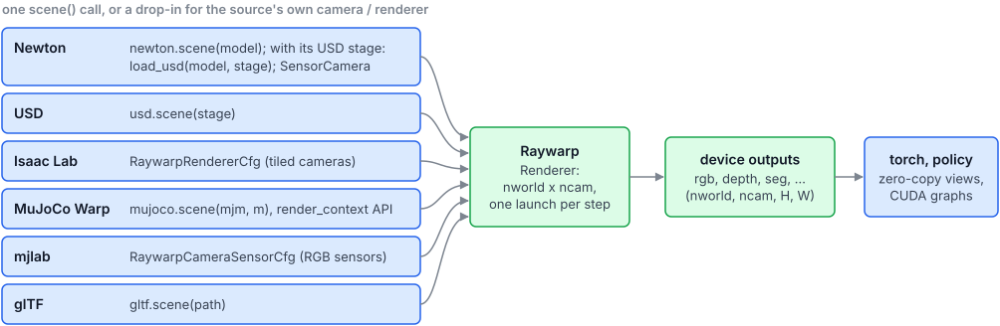

# Quickstart

Render your first batch of images. Newton with a USD stage comes first; MuJoCo Warp, mjlab,
Isaac Lab and plain USD / glTF files follow. Every snippet runs as is on the CPU; on a GPU
machine the same code runs on `cuda:0`.



## Quick start

```bash
pip install "raywarp[newton,usd]"   # Python >= 3.12
```

Load a USD robot into Newton, replicate it into four worlds and render them in one call:

<!-- SHOWCASE: quickstart/newton.webp (docs/assets/SHOTS.md) -->


```python
import newton
import newton.examples
import numpy as np
import warp as wp

import raywarp as rw
import raywarp.integrations.newton

STAGE = newton.examples.get_asset("ant.usda")  # any USD stage
robot = newton.ModelBuilder()
robot.add_usd(STAGE)
builder = newton.ModelBuilder()
builder.add_ground_plane()
builder.replicate(robot, 4)  # 4 worlds
model = builder.finalize()
state = model.state()

scene = rw.integrations.newton.scene(model, lighting=rw.Lighting.studio())  # Newton models carry no lights
r = rw.Renderer(scene, nworld=model.world_count, cameras=[rw.CameraSpec(fovy=60)], resolution=(64, 48))
eye = wp.transformf((0.0, -3.0, 1.2), wp.quat_from_axis_angle(wp.vec3(1.0, 0.0, 0.0), 1.35))
r.camera_pose.fill_(eye)  # every world's free camera; -z forward, +y up
out = r.render(state)
assert out.rgb.shape == (4, 1, 48, 64)  # (nworld, ncam, H, W) RGBA bytes
rgba = out.rgb.numpy()  # (4, 1, 48, 64, 4) uint8: a host copy, for looking
```

What happened:

- `rw.integrations.newton.scene(model)` puts the model's visible shapes on the device. It reads
  the body poses from `state.body_q` on every render, with no host copy.
- `lighting=rw.Lighting.studio()` adds a neutral sky, key and fill light.
- `rw.Renderer` renders `nworld` worlds x the listed cameras on every call.
- `r.render(state)` returns `r.outputs`: the same device arrays every frame, written in place.
  Swapping Newton's `state_0` / `state_1` needs nothing.
- `.numpy()` copies to the host. For training, read the outputs on the device with
  `out.torch()` ([robotics recipes](robotics.md)).

## Newton with the stage's own materials and lights

| | |
| --- | --- |
| what it is | the USD stage's materials, textures, UsdLux lights and cameras, moved by Newton's bodies |
| how to use | `rw.integrations.newton.load_usd(model, stage)`, then `rw.upload` with `binding(host, model, stage=stage)` |
| outputs | every Raywarp output |
| limits | the model must have been loaded from that stage; shapes added in code (a ground plane) are kept |

`scene(model)` above renders Newton's shapes with their colours. To render the stage as authored,
load it next to the model and bind its prims to the model's bodies:

```python
host = rw.integrations.newton.load_usd(model, STAGE, lighting=rw.Lighting.studio())  # a host rw.Scene
usd_scene = rw.upload(host, model.device, binding=rw.integrations.newton.binding(host, model, stage=STAGE))
r = rw.Renderer(usd_scene, nworld=model.world_count, cameras=[rw.CameraSpec(fovy=60)], resolution=(64, 48))
r.camera_pose.fill_(eye)
out = r.render(state)
```

`load_usd` keeps the converted stage in a `.rayw` cache file, so a second load is fast.
`rw.integrations.newton.load(model)` is the host-scene step of `scene(model)`, for a scene you
want to edit or save first.

## Newton's camera sensor: SensorCamera

| | |
| --- | --- |
| what it is | a drop-in for `newton.sensors.SensorCamera`, PBR shaded |
| how to use | change one import; the constructor and `update()` are Newton's |
| outputs | `color_image` PBR shaded and tone mapped; depth, shape index, normal and albedo match Newton's |
| limits | loose particles and Gaussians are not rendered; Newton 1.7 and main |

```python
from raywarp.integrations.newton.sensor import SensorCamera  # instead of: from newton.sensors import SensorCamera

camera = SensorCamera(model)  # PBR options too: lighting=rw.Lighting(...), **{"aa.spp": 2}
rays = SensorCamera.compute_camera_rays_pinhole(64, 48, camera_fov=1.0)
views = wp.array([eye] * model.world_count, dtype=wp.transformf)  # one camera transform per world
color = camera.allocate_image_color(model.world_count, 64, 48)
depth = camera.allocate_image_depth(model.world_count, 64, 48)
camera.update(state, views, rays, color_image=color, depth_image=depth)
```

| topic | behaviour |
| --- | --- |
| supported API | `compute_camera_rays_*`, `world_indices` with `WorldRenderFlag`, `ClearData`, `RenderConfig`, `allocate_image_*`, `create_default_light`, `set_ambient_light`, `assign_checkerboard_material` |
| extra options | `lighting=rw.Lighting(...)` ([lighting a scene](scenes.md#lighting-a-scene)) and any dotted settings field |
| CUDA graph | `graph = camera.capture(lambda: camera.update(...))`, then `graph.launch()` |
| cloth and soft bodies | rendered from `state.particle_q` |
| different shapes per world | supported: each world shows its own |
| no lights given | a key and a fill light |

## Newton's viewer, headless

| | |
| --- | --- |
| what it is | a Newton `ViewerNull` that ray traces each frame, with no window and no OpenGL |
| how to use | replace the viewer of a Newton example; the calls are the same |
| outputs | `viewer.get_frame()`: the last frame |
| limits | needs `pyglet` (for the camera maths only; no display) |

```python
# docs: requires pyglet
from raywarp.integrations.newton.headless import ViewerRaywarpHeadless

viewer = ViewerRaywarpHeadless(width=64, height=48, num_frames=2)
viewer.set_model(model)
viewer.set_camera(wp.vec3(3.0, -2.0, 1.5), pitch=-20.0, yaw=150.0)
while viewer.is_running():
  viewer.begin_frame(0.0)
  viewer.log_state(state)
  viewer.end_frame()
frame = viewer.get_frame()  # the last frame
```

Extra options: `lighting`, `usd` (use the stage's materials and lights), `scene_options` and any
dotted settings field. Without lights it reproduces the look of Newton's ViewerGL.

With Newton's SolverMuJoCo, also install Newton's own extra:
`pip install "raywarp[mujoco,newton]" "newton[sim]"`. It pins the MuJoCo version the solver supports.

## MuJoCo Warp

| | |
| --- | --- |
| what it is | renders a MuJoCo Warp model and its batched `mjw.Data` |
| how to use | `rw.integrations.mujoco.scene(mjm, m)`, then `r.render(d)` |
| outputs | every Raywarp output |
| limits | none specific: the model's arrays are read in place, so writing `m.geom_rgba` changes the next frame |

```bash
pip install "raywarp[mujoco]"
```

Eight worlds, two cameras each, three outputs:

<!-- SHOWCASE: quickstart/mujoco.webp (docs/assets/SHOTS.md) -->


```python
import mujoco
import mujoco_warp as mjw

import raywarp.integrations.mujoco

XML = """
<mujoco>
  <worldbody>
    <light type="directional" dir="0.3 0.2 -1" castshadow="true"/>
    <light pos="0.5 -0.5 1.5" intensity="0" bulbradius="0.1"/>
    <geom type="plane" size="3 3 0.1" rgba="0.7 0.7 0.7 1"/>
    <body name="ball" pos="0 0 0.4">
      <freejoint/>
      <geom name="ball" type="sphere" size="0.2" rgba="0.8 0.3 0.2 1"/>
    </body>
    <geom name="crate" type="box" pos="0.6 0.2 0.2" size="0.2 0.2 0.2" rgba="0.2 0.4 0.9 1"/>
    <camera name="front" pos="0 -2.5 1.2" xyaxes="1 0 0 0 0.45 0.9" fovy="50"/>
    <camera name="side" pos="2 0 1" xyaxes="0 1 0 -0.4 0 0.9" fovy="60"/>
  </worldbody>
</mujoco>
"""
mjm = mujoco.MjModel.from_xml_string(XML)
m = mjw.put_model(mjm)
d = mjw.make_data(mjm, nworld=8)

mj = rw.Renderer(
  rw.integrations.mujoco.scene(mjm, m),  # reads MuJoCo Warp's arrays in place: no copy
  nworld=8,
  cameras=["front", "side"],  # MJCF camera names
  resolution=(64, 48),  # (width, height)
  settings=rw.RenderSettings(outputs=rw.Outputs.of("rgb", "depth", "seg")),
)
mjw.step(m, d)
out = mj.render(d)  # poses from d
assert out.rgb.shape == (8, 2, 48, 64)
depth = out.depth.numpy()  # float32 planar depth, 0 where nothing is hit
seg = out.seg.numpy()  # int32 geom id, -1 where nothing is hit
assert {0, 1, 2} <= set(np.unique(seg))
```

Already using MuJoCo Warp's own renderer? `rw.integrations.mujoco` has the same API. Change the
import:

```python
from raywarp.integrations import mujoco as render  # instead of: import mujoco_warp as render

rc = render.create_render_context(mjm, nworld=8, cam_res=(64, 48), render_rgb=True, render_depth=True)
render.render(m, d, rc)
rgb = wp.zeros((8, 48, 64), dtype=wp.vec3)  # MuJoCo Warp's per-camera output arrays
render.get_rgb(rc, 0, rgb)
```

`create_render_context` takes MuJoCo Warp's arguments (`use_shadows`, `use_textures`,
`samples_per_pixel`, ...) plus `settings=` for anything else.

## mjlab

| | |
| --- | --- |
| what it is | an RGB backend of mjlab's camera sensors |
| how to use | `RaywarpCameraSensorCfg`, or a plain `CameraSensorCfg` with `rgb_backend="raywarp"` |
| outputs | RGB, written straight into the uint8 tensor mjlab reads |
| limits | `raywarp_settings` must agree with the sensor's `use_shadows` / `use_textures` (it raises otherwise) |

```bash
pip install "raywarp[mujoco]" mjlab
```

```python
# docs: requires mjlab cuda
from mjlab.entity import EntityCfg
from mjlab.scene import Scene, SceneCfg
from mjlab.sim import Simulation, SimulationCfg

from raywarp.integrations.mjlab import RaywarpCameraSensorCfg

ROOM = """
<mujoco><worldbody>
  <light pos="0 0 3" dir="0 0 -1"/>
  <geom type="plane" size="2 2 0.1"/><geom type="box" size="0.2 0.2 0.2" pos="0 0 0.2" rgba="0.9 0.1 0.1 1"/>
  <camera name="front" pos="0 -2 1" xyaxes="1 0 0 0 0.45 0.9"/>
</worldbody></mujoco>"""
front = RaywarpCameraSensorCfg(
  name="front",
  camera_name="room/front",
  width=64,
  height=64,
  raywarp_settings=rw.RenderSettings().replace(rw.FAST),  # max throughput (None: the default)
)
nenv = 4
lab = Scene(
  SceneCfg(num_envs=nenv, entities={"room": EntityCfg(spec_fn=lambda: mujoco.MjSpec.from_string(ROOM))}, sensors=(front,)),
  "cuda:0",
)
sim = Simulation(nenv, SimulationCfg(), lab.compile(), "cuda:0")
lab.initialize(sim.mj_model, sim.model, sim.data)
sim.set_sensor_context(lab.sensor_context)
sim.forward()
lab.sensor_context.render_rgb()
rgb = lab.sensor_context.get_rgb(mujoco.mj_name2id(sim.mj_model, mujoco.mjtObj.mjOBJ_CAMERA, "room/front"))
assert tuple(rgb.shape) == (nenv, 64, 64, 3)  # a uint8 torch tensor, written in place
```

- Sensors with the same resolution and settings share one renderer.
- `raywarp_per_world=rw.PerWorld(pose=["table/*"])` declares the mocap entities that reset
  events move per world.
- mjlab's randomisation events work unchanged ([domain randomisation](domain_randomisation.md#mjlab)).

## Isaac Lab

> **New in 0.4.0:** the Isaac Lab renderer ships with Raywarp from this release.

| | |
| --- | --- |
| what it is | an Isaac Lab 3.0 camera renderer, next to Isaac's Newton Warp and RTX renderers |
| how to use | give a camera `renderer_cfg=RaywarpRendererCfg(...)` |
| outputs | Isaac's `(N, H, W, C)` arrays, written in place (table below) |
| limits | no `motion_vectors`, colourised segmentation, simple-shading modes or lens distortion |

```python
# docs: requires isaaclab
from isaaclab.sensors.camera import TiledCameraCfg

import raywarp as rw
from raywarp.integrations.isaaclab.cfg import RaywarpRendererCfg

camera = TiledCameraCfg(
  prim_path="{ENV_REGEX_NS}/Camera",
  width=128,
  height=128,
  data_types=["rgb", "depth"],
  renderer_cfg=RaywarpRendererCfg(settings={**rw.FAST, "shadows.enabled": True}),
)
```

| topic | behaviour |
| --- | --- |
| scene | the Newton model Isaac Lab builds for its renderers, with PhysX or Newton physics; body poses are read on the GPU every frame |
| outputs written | `rgb`, `rgba`, `rgb_hdr`, `albedo`, `depth` / `distance_to_image_plane`, `distance_to_camera`, `normals` (world space), `instance_segmentation`, `semantic_segmentation` |
| segmentation | int32 ids grouped as Isaac's Newton Warp renderer does; 0 background, 1 unlabelled; labels in `camera.data.info[...]["idToLabels"]` |
| misses | follow `depth_clipping_behavior`: `"none"` (inf, like Isaac RTX), `"zero"` or `"max"` |
| per environment | camera pose, intrinsics and `randomize_visual_color` events, with no recompile |
| look | `settings`: dotted overrides of the default (`{**rw.FAST}` for maximum throughput); `lighting`: a `rw.Lighting` (default: a key and a fill light) |

Install Isaac Lab first, then Raywarp without its dependencies, then Warp 1.18. Isaac Lab 3.0.0
pins Warp 1.17 and Newton 1.6.1. Keep its Newton: Isaac Lab 3.0.0 breaks with Newton 1.7.
These commands were checked on an NVIDIA L4 (Python 3.12, without Kit), with Newton physics only:

```bash
uv venv -p 3.12 && . .venv/bin/activate
uv pip install --extra-index-url https://pypi.nvidia.com --index-strategy unsafe-best-match "isaaclab==3.0.0"
uv pip install --no-deps "raywarp>=0.4"
uv pip install "warp-lang>=1.18,<1.19"
```

## USD and glTF without a simulator

| | |
| --- | --- |
| what it is | a static USD stage or glTF 2.0 file, rendered as it is authored |
| how to use | `rw.formats.usd.scene(path)` or `rw.formats.gltf.scene(path)`, then `r.render()` |
| outputs | every Raywarp output |
| limits | nothing moves unless you pose it (`PerWorld(pose=...)`, [domain randomisation](domain_randomisation.md)) |

```bash
pip install "raywarp[usd]"    # USD stages
pip install "raywarp[gltf]"   # glTF 2.0
```

<!-- SHOWCASE: quickstart/usd.webp (docs/assets/SHOTS.md) -->


```python
from pathlib import Path

import raywarp.formats.usd

Path("demo.usda").write_text("""#usda 1.0
(
  upAxis = "Z"
  metersPerUnit = 1
)
def Xform "World"
{
  def Cube "floor"
  {
    double size = 2
    float3 xformOp:scale = (3, 3, 0.02)
    double3 xformOp:translate = (0, 0, -0.02)
    uniform token[] xformOpOrder = ["xformOp:translate", "xformOp:scale"]
    color3f[] primvars:displayColor = [(0.7, 0.7, 0.7)]
  }
  def Sphere "ball"
  {
    double radius = 0.3
    double3 xformOp:translate = (0, 0, 0.3)
    uniform token[] xformOpOrder = ["xformOp:translate"]
    color3f[] primvars:displayColor = [(0.8, 0.3, 0.2)]
  }
  def DistantLight "sun"
  {
    float inputs:intensity = 50000  # full sun [lux]; exposure adapts automatically
    bool inputs:normalize = 1
    float inputs:angle = 1
    float3 xformOp:rotateXYZ = (30, 20, 0)
    uniform token[] xformOpOrder = ["xformOp:rotateXYZ"]
  }
  def Camera "camera"
  {
    double3 xformOp:translate = (0, -3, 1.2)
    float3 xformOp:rotateXYZ = (70, 0, 0)
    uniform token[] xformOpOrder = ["xformOp:translate", "xformOp:rotateXYZ"]
  }
}
""")
gpu = rw.formats.usd.scene("demo.usda", cache="raywarp_cache")
print(gpu.report)  # what was dropped or approximated, counts, timings
static = rw.Renderer(gpu, nworld=1, cameras=None, resolution=(64, 48))  # None: the stage's cameras
out = static.render()  # a static scene: no simulator state
assert out.rgb.numpy()[..., :3].mean() > 10
```

The first load converts the stage and keeps the result in a `.rayw` file. A second load of an
unchanged stage maps that file in a fraction of a second.

| you want | write |
| --- | --- |
| inspect or edit the scene before upload | `host = rw.formats.usd.load(path)`, edit (`host.with_lighting(...)`), then `rw.upload(host)` |
| keep the cache somewhere else | `cache="dir"` or `cache="scene.rayw"` (default: `~/.cache/raywarp`, or `$RAYWARP_CACHE_DIR`) |
| no cache | `cache=None` for one load; `RAYWARP_CACHE_DIR=""` for every load |
| bake a big stage once, offline | `rw.formats.usd.bake(stage, "office.rayw")` |
| the stage's Omniverse render settings | `rw.formats.usd.settings(stage)` ([settings](settings.md#usd-stages)) |

## Warm up before the first frame

The GPU code is prebuilt: the first renderer on a machine downloads what its settings need, and
nothing compiles. The first frame still loads that code, uploads the scene and runs its one-time
precomputations. `rw.Renderer.warm` does all of it ahead, in the background, and stores it on
disk. A later renderer with the same arguments, even in another process, starts at once.

```python
setup = {"nworld": model.world_count, "cameras": [rw.CameraSpec(fovy=60)], "resolution": (64, 48)}  # the Newton scene above
fast = rw.RenderSettings().replace(rw.FAST)
warms = [rw.Renderer.warm(scene, **setup, settings=s, sim=state) for s in (rw.RenderSettings(), fast)]
print([str(w.result()) for w in warms])  # per step: seconds, cache entries added
r = rw.Renderer(scene, **setup, settings=fast)  # starts warm
```

`warm` returns a `concurrent.futures.Future`. Start one per configuration your run uses: they
run together. Offline machines, mirrors and cache locations:
[how the kernels work](performance.md#how-the-kernels-work).

## See also

- [Concepts](concepts.md): the model behind the API.
- [Examples](../examples/): small runnable scripts for each integration.
- [Scenes](scenes.md): lights, environment maps, materials and textures, cameras, the load report.
- [Robotics recipes](robotics.md): torch, outputs, CUDA graphs.
- [Domain randomisation](domain_randomisation.md): a different look per world.
- [Recording video](recording.md): MP4 files of any batch.
- [Troubleshooting](faq.md): dark images, slow first frames, settings that did not take effect.
