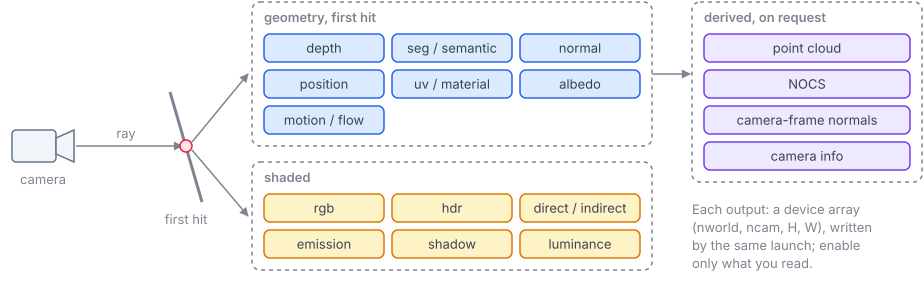
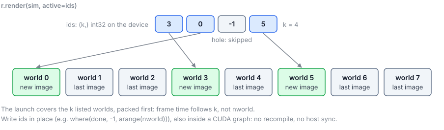

# Robotics recipes

Patterns for training pipelines: observations in torch with no copy, the outputs a policy can
read, point clouds, sensor effects, one CUDA graph per step and skipping finished episodes.

## Quick start

Every snippet of this page shares one small MuJoCo Warp scene: a ball on a textured table, two
distractors and a light.

```python
import mujoco
import mujoco_warp as mjw
import numpy as np
import warp as wp

import raywarp as rw
import raywarp.integrations.mujoco

XML = """
<mujoco>
  <asset>
    <texture name="wood" type="2d" builtin="checker" rgb1="0.6 0.4 0.2" rgb2="0.4 0.25 0.1" width="32" height="32"/>
    <material name="table" texture="wood" texrepeat="3 3"/>
  </asset>
  <worldbody>
    <light name="key" pos="0.5 -0.5 2" dir="-0.2 0.2 -1" castshadow="true"/>
    <geom name="table" type="box" size="1 1 0.02" pos="0 0 -0.02" material="table"/>
    <geom name="distractor_cube" type="box" size="0.08 0.08 0.08" pos="0.5 0.4 0.08" rgba="0.2 0.7 0.3 1"/>
    <geom name="distractor_ball" type="sphere" size="0.08" pos="-0.5 0.4 0.08" rgba="0.8 0.8 0.2 1"/>
    <body name="object" pos="0 0 0.1">
      <freejoint/>
      <geom name="object" type="sphere" size="0.1" rgba="0.9 0.2 0.1 1"/>
    </body>
    <camera name="overhead" pos="0 -1.6 1.4" xyaxes="1 0 0 0 0.66 0.75" fovy="45"/>
  </worldbody>
</mujoco>
"""
NWORLD = 16
mjm = mujoco.MjModel.from_xml_string(XML)
m = mjw.put_model(mjm)
d = mjw.make_data(mjm, nworld=NWORLD)
mjw.forward(m, d)
scene = rw.integrations.mujoco.scene(mjm, m)
```

## Feed observations to torch with no copy

`out.torch()` returns zero-copy torch views of the outputs. They are created once and point at
the same memory every frame.

```python
# docs: requires torch
r = rw.Renderer(
  scene,
  nworld=NWORLD,
  cameras=["overhead"],
  resolution=(64, 64),
  settings=rw.RenderSettings().replace(rw.FAST).replace(**{"outputs": rw.Outputs.of("rgb", "depth")}),
)
obs = r.render(d).torch()
rgb = obs["rgb"][..., :3]  # (nworld, ncam, H, W, 3) uint8 view of the RGBA bytes
depth = obs["depth"]  # (nworld, ncam, H, W) float32
```

Every output is world-major: `(nworld, ncam, H, W)`, with the per-pixel value as the element
type. In torch and NumPy that value becomes a trailing channel axis. `ColorOutput` picks how the
colour is stored:

| `ColorOutput(...)` | `out.rgb` (Warp) | `out.torch()["rgb"]` | bytes / pixel |
|---|---|---|---|
| `()` (default) | `(nworld, ncam, H, W)` vec4ub RGBA | `(nworld, ncam, H, W, 4)` uint8 | 4 |
| `(channels=3)` | `(nworld, ncam, H, W)` vec3ub RGB | `(nworld, ncam, H, W, 3)` uint8 | 3 |
| `(channels=3, planar=True)` | `(nworld * ncam, 3, H, W)` uint8 planes | `(nworld, ncam, 3, H, W)` uint8 | 3 |
| `(channels=3, planar=True, dtype="float16")` | `(nworld * ncam, 3, H, W)` float16 in [0, 1] | `(nworld, ncam, 3, H, W)` float16 | 6 |

Warp arrays have at most four axes, so the planar Warp view merges worlds and cameras: row
`w * ncam + c`. A policy that wants channels-first input can hand its own tensor to the renderer
with `bind_outputs`. The renderer then writes the policy's tensor directly:

```python
# docs: requires torch
import torch

planar = rw.settings.ColorOutput(channels=3, planar=True, dtype="float16")
r = rw.Renderer(
  scene,
  nworld=NWORLD,
  cameras=["overhead"],
  resolution=(64, 64),
  settings=rw.RenderSettings().replace(rw.FAST).replace(outputs=rw.Outputs(rgb=planar)),
)
policy_input = torch.zeros((NWORLD, 3, 64, 64), dtype=torch.float16, device=str(r.device))
r.bind_outputs(rgb=wp.from_torch(policy_input.view(-1)))  # the renderer writes the policy's tensor
r.render(d)
assert r.outputs.torch()["rgb"].shape == (NWORLD, 1, 3, 64, 64)
```

The bound array must be contiguous, with the right element count, dtype and device. A rejected
binding leaves the previous outputs in place.

Other frameworks:

| framework | how |
| --- | --- |
| mjlab | the RGB bytes go straight into the tensor mjlab reads ([quickstart](quickstart.md#mjlab)) |
| JAX (MJX, MuJoCo Playground) | `raywarp.integrations.mujoco.mjx.feed(d, mjx_data)` copies a JAX state's poses into the `mjw.Data` the renderer reads; `raywarp.integrations.mujoco.mjx.to_jax(r.outputs)` views the outputs as JAX arrays. No host synchronisation, and a captured graph keeps replaying. |

> **New in 0.4.0:** the JAX bridge (`raywarp.integrations.mujoco.mjx`).

## Outputs: what you can request and what it costs



Ask for exactly the images the policy reads. `rw.Outputs` has one field per output: its spec
when requested, `None` otherwise. Only requested outputs are allocated and written.

<!-- SHOWCASE: robotics/outputs.webp (docs/assets/SHOTS.md) -->


```python
outputs = rw.Outputs(
  rgb=rw.settings.ColorOutput(),  # display sRGB, (nworld, ncam, H, W) vec4ub
  depth=rw.settings.DepthOutput(convention="planar", miss="inf", dtype="float16"),
  seg=rw.settings.IdOutput(),  # instance ids
  semantic=rw.settings.IdOutput(),  # class ids (Renderer.set_semantics), in the same frame
  normal=rw.settings.NormalOutput(frame="geometric", dtype="float16"),
)
r = rw.Renderer(
  scene,
  nworld=NWORLD,
  cameras=["overhead"],
  resolution=(64, 48),
  settings=rw.RenderSettings().replace(rw.FAST).replace(outputs=outputs),
)
out = r.render(d)
assert out.depth.dtype == wp.float16 and out.albedo is None  # not requested: None
# The same request by name with default specs, or from plain data (a JSON config, a CLI flag):
assert rw.Outputs.of("rgb", "seg") == rw.Outputs.parse({"rgb": {}, "seg": {}}) == rw.Outputs.parse("rgb,seg")
```

> **New in 0.4.0:** `position`, `uv`, `material`, `roughness`, `metallic`, `emission`,
> `direct` / `indirect`, `shadow`, `luminance`, `semantic` together with `seg`, a geometric
> `normal`, and float16 variants of every float output.

| output | spec (options) | holds | dtype |
|---|---|---|---|
| `rgb` | `ColorOutput(channels, dtype, planar, alpha)` | display colour: RGBA, RGB or channels-first planes (uint8 or float16); `alpha=True`: coverage in the alpha byte | vec4ub |
| `depth` | `DepthOutput(convention, miss, dtype)` | planar or radial depth; misses `"zero"`, `"inf"` or `"far"` | float32 / 16 |
| `seg` | `IdOutput()` | segment (instance) id, -1 on a miss | int32 |
| `semantic` | `IdOutput()` | class id (`set_semantics`; 1 unlabelled), 0 on a miss | int32 |
| `material` | `IdOutput()` | material id, -1 without one | int32 |
| `position` | `FloatOutput(dtype)` | world-space hit point [m] | vec3 / vec3h |
| `uv` | `FloatOutput(dtype)` | the texture coordinate the maps read | vec2 / vec2h |
| `normal` | `NormalOutput(frame, dtype)` | unit normal facing the camera: `"shading"` (smooth, normal maps) or `"geometric"` | vec3 / vec3h |
| `albedo` | `FloatOutput(dtype)` | linear base colour | vec3 / vec3h |
| `roughness`, `metallic` | `FloatOutput(dtype)` | as shaded (textured) | float32 / 16 |
| `emission` | `FloatOutput(dtype)` | the emitted part of the hit's radiance | vec3 / vec3h |
| `direct`, `indirect` | `FloatOutput(dtype)` | radiance from the lights / from everything else but emission | vec3 / vec3h |
| `shadow` | `ShadowOutput(light, dtype)` | visible fraction of one light (an index, `"sun"`, `"strongest"`) | float32 / 16 |
| `hdr` | `FloatOutput(dtype)` | linear radiance before exposure | vec3 / vec3h |
| `luminance` | `LuminanceOutput(dtype)` | Rec. 709 luminance of the display colour: a grey camera | uint8 / float16 |
| `motion` | `MotionOutput(status)` | screen-space motion of the first hit since the previous frame [px] | vec2 |
| `flow_status` | `MotionOutput(status=True)` | why each pixel's motion is valid or not (below) | uint8 |

What the values mean:

| topic | rule |
| --- | --- |
| first hit | every output but rgb, hdr and luminance describes the nearest surface of the pixel-centre ray. Translucent layers count; alpha cut-outs do not. |
| anti-aliasing | averages rgb, hdr and luminance only. Other outputs are never blended: an edge pixel holds one surface's id, depth or normal. |
| misses | write 0, except seg and material (-1), shadow (1) and depth (its `miss` value) |
| direct + indirect + emission = hdr | on hit pixels of an opaque, unfogged render at `aa.spp=1`, to float rounding |
| shadow | traces the light's shadow ray once more at the first hit; 0 where the surface faces away, 1 for a light without shadows |
| float16 | the float32 value rounded to half precision (above 65504: inf); half the memory, the same compute |
| automatic exposure | the default; it also keeps an internal HDR image (6 bytes per pixel); `exposure.mode="manual"` turns it off |

**Motion status** (`MotionOutput(status=True)` adds `flow_status`, values in
`rw.RenderOutputs.FlowStatus`):

| status | meaning |
| --- | --- |
| `VALID` | the point was visible at the motion's target in the previous frame |
| `MISS` | background |
| `OUT_OF_FRAME` | outside the previous image or beyond its far plane (the motion still points there) |
| `BEHIND` | behind the previous camera's near plane (motion 0) |
| `OCCLUDED` | hidden by a nearer surface in the previous frame (a disocclusion) |
| `UNKNOWN` | no reprojection: the first frame after a reset, deformable hits, moving per-pixel ray cameras |

### Render depth and labels only

When nothing shaded is requested (only depth, seg, semantic, position, uv, material, a
geometric normal and motion), the renderer traces one closest hit per pixel. No shading, light or
texture work runs, and it is much faster than a colour render.

```python
geometry = rw.Outputs.of("depth", "seg", "position", normal=rw.settings.NormalOutput(frame="geometric"))
r = rw.Renderer(
  scene,
  nworld=NWORLD,
  cameras=["overhead"],
  resolution=(64, 48),
  settings=rw.RenderSettings().replace(rw.FAST).replace(outputs=geometry),
)
out = r.render(d)
```

### What each output costs

Each output added alone to `rgb`, RTX PRO 6000, OptiX, ms per step and renderer memory.
G1 = the Unitree G1 benchmark scene, 32 worlds x 2 cameras at 512 x 512.
Office = the Isaac Office, 16 cameras at 1024 x 1024.

| output | G1 512², `FAST` (rgb 1.29 ms) | G1 512², default (rgb 4.05 ms) | Office 1024², `FAST` (rgb 8.87 ms) | memory (G1 / Office) |
|---|---|---|---|---|
| alpha | +0.01 ms | -0.01 ms | -0.06 ms | 0 |
| depth / depth16 | +0.05 / +0.03 ms (+4 / +3 %) | +0.02 / +0.00 ms | 0.00 / -0.03 ms | 64 / 32 MB |
| seg, semantic, material | +0.05 ms (+4 %) each | +0.01-0.04 ms | 0.0 ms | 64 MB each |
| seg + semantic | +0.09 ms (+7 %) | +0.05 ms (+1 %) | +0.05 ms (+1 %) | 128 MB |
| hdr / hdr16 | +0.06 / +0.09 ms (+4 / +7 %) | +0.05 / +0.07 ms | +0.01 / -0.01 ms | 192 / 96 MB |
| albedo, normal, position | +0.05 ms (+4 %) each | +0.02-0.04 ms | +0.02-0.09 ms (+1 %) | 192 MB each |
| normal16 / position16 | +0.07 / +0.08 ms (+6 / +7 %) | +0.07 / +0.05 ms | +0.05 / 0.00 ms | 96 MB each |
| uv | +0.20 ms (+15 %) | +0.12 ms (+3 %) | +0.24 ms (+3 %) | 128 MB |
| roughness, metallic | +0.04 ms (+3 %) | 0.00 ms | -0.02 ms | 64 MB each |
| emission, direct, indirect | +0.05 ms (+4 %) each | +0.02-0.04 ms | 0.00 ms | 192 MB each |
| shadow | +0.31 ms (+24 %) | +0.36 ms (+9 %) | +0.24 ms (+3 %) | 64 MB |
| luminance / luminance16 | +0.01 / +0.03 ms | +0.03 / +0.01 ms | -0.05 / -0.03 ms | 16 / 32 MB |
| motion | +0.33 ms (+26 %) | +0.35 ms (+9 %) | +0.52 ms (+6 %) | 128 MB |
| rgb planar uint8 / float16 (with RGBA) | +0.07 / +0.08 ms (+6 %) | +0.04 / +0.07 ms | -0.01 / +0.01 ms | 48 / 96 MB |

Most outputs store a value the shading already has, so they cost their write: a few percent of a
light frame, nothing measurable on a heavy one. `uv` looks the texture coordinates up again,
`shadow` traces shadow rays again, and `motion` keeps the previous frame's poses. float16 halves
the memory but does not make the step faster at these sizes.

Depth + seg only, same GPU: Office 16 x 1024² takes 0.81 ms (`FAST` colour: 8.87 ms), G1
64 x 512² takes 0.88 ms (1.29 ms).

<a id="point-clouds-and-per-world-labels"></a>

## Get point clouds and per-world labels

`r.point_cloud(npoints)` turns the last render's depth into world-space points: one cloud per
world, all cameras fused (or `cameras=[...]`). It runs on the device with no host
synchronisation. With the depth-and-labels renderer above:

```python
from raywarp.core.outputs.semantic_classes import body_instances

ball = body_instances(mjm, "object")  # the geoms of the body "object" and of its children
cloud = r.point_cloud(256, labels="seg", keep=ball, seed=0)
assert cloud.points.shape == (NWORLD, 256) and (cloud.count.numpy() > 0).all()  # (nworld, N) vec3 [m]
cloud = r.point_cloud(256, labels="seg", keep=ball, seed=0, out=cloud)  # written in place
```

<!-- SHOWCASE: robotics/point_cloud.webp (docs/assets/SHOTS.md) -->


| argument | effect |
| --- | --- |
| `npoints=N` | resamples to N points per world, deterministically from `seed`; `cloud.count` says how many are distinct |
| `npoints=None` | every kept pixel, compacted, zeros past `count` |
| `labels="seg"` / `"semantic"` | returns each point's id (`cloud.ids`); `keep` filters on it |
| `colors=True` | each point's display colour (needs `rgb`) |
| `out=cloud` | writes an existing cloud: nothing is allocated, so a captured graph can run it |

**Per-world semantic labels.** `r.set_semantics(rules, worlds=...)` labels the instances of the
given worlds only (world indices or a `(nworld,)` bool mask). One label list serves every world:
an id means the same class everywhere.

```python
r.set_semantics({"target": ball})  # every world
r.set_semantics({"target": "distractor_cube", "ball": ball}, worlds=np.arange(NWORLD) % 2 == 1)
assert r.semantic_labels == ("background", "unlabelled", "target", "ball")  # one list, every world
```

The first per-world call makes captured graphs stale: call it before capturing. A call without
`worlds` relabels every world and restarts the numbering.

## Randomise the look per world

Declare what varies with `rw.PerWorld(...)`, then write `r.per_world[...]` tables between frames.
Nothing recompiles. A minimal example:

```python
r = rw.Renderer(
  scene, nworld=NWORLD, cameras=["overhead"], resolution=(64, 64), per_world=rw.PerWorld(material=["base_color"])
)
color = r.per_world["material.base_color"]  # (nworld, nmaterial) RGBA: RGB tints
tint = color.numpy()
tint[..., :3] = np.random.default_rng(0).uniform(0.2, 1.0, tint[..., :3].shape)
color.assign(tint)
r.render(d)
```

Every randomisable quantity, each simulator's tables, GI and costs:
[domain randomisation](domain_randomisation.md).

<a id="sensor-effects-noise-vignette-response-stereo-depth-rolling-shutter-motion-blur"></a>

## Add camera sensor effects

The `sensor` settings add what a real camera and depth sensor add to the images: noise,
vignette, a response curve, stereo depth errors, rolling shutter and motion blur. Everything is
off by default and costs nothing while off. Switching an effect never recompiles.

```python
sim2real = (
  rw.RenderSettings()
  .replace(rw.FAST)
  .replace(
    outputs=rw.Outputs.of("rgb", "depth", "motion"),
    sensor={
      "noise": True,
      "full_well": 4000.0,
      "read_noise": 3.0,  # Poisson shot + Gaussian read noise [e-]
      "vignette": (-0.3, 0.0, 0.0),  # 1 + a1 r^2 + a2 r^4 + a3 r^6 <= 1 (Isaac PPISP)
      "rolling_shutter": 0.5,
      "motion_blur": 0.3,  # readout / exposure time over the frame interval
      "depth": "stereo",
      "baseline": 0.05,
      "disparity_noise": 0.08,  # RealSense D400-class active stereo
    },
  )
)
```

The effects apply to the final `rgb`, `luminance` and `depth`. `hdr`, `albedo` and the other
outputs stay clean.

| effect | behaviour |
| --- | --- |
| noise | seeded by the render seed, world, pixel and frame: new noise every frame, independent of the batch size. Display white is `full_well` electrons. |
| response curve | `response`: toe, shoulder, centre, gamma; (1, 1, 0.5, 1) is the identity |
| stereo depth | the camera is the left imager of a pair `baseline` metres apart. Pixels the right imager cannot see, out of range or dropped read the depth's miss value. Undistorted perspective cameras only. |
| rolling shutter, motion blur | resample the image along each pixel's motion vector; they need the `motion` output |
| per world | `PerWorld(env=["sensor.noise", "sensor.vignette", "sensor.response"])`, then write `r.per_world["sensor.noise"]` (full well, read noise) |
| cost | one pass over the colour and / or the depth, only while an effect is on |

<!-- SHOWCASE: robotics/sensor_noise.webp (docs/assets/SHOTS.md) -->


<!-- SHOWCASE: robotics/rolling_shutter.webp (docs/assets/SHOTS.md) -->
[](assets/robotics/rolling_shutter.mp4)

## Step and render in one CUDA graph

`r.capture(step, sim)` runs the simulator step and the render once, then records both in one
CUDA graph. Each step is then one launch, with no host synchronisation.

```python
# docs: requires cuda
with wp.ScopedDevice("cuda:0"):
  gm = mjw.put_model(mjm)
  gd = mjw.make_data(mjm, nworld=4096)
  gpu_scene = rw.integrations.mujoco.scene(mjm, gm)
  gr = rw.Renderer(
    gpu_scene, nworld=4096, cameras=["overhead"], resolution=(64, 64), settings=rw.RenderSettings().replace(rw.FAST)
  )
  graph = gr.capture(lambda: mjw.step(gm, gd), sim=gd)
  for _ in range(100):
    graph.launch(gd)  # physics + render
  obs = gr.outputs.rgb
```

A captured render reads its random seed from a device `int32` array of shape `(1,)`:

```python
# docs: requires cuda
seed = wp.zeros(1, dtype=wp.int32, device=gr.device)
graph = gr.capture(lambda: mjw.step(gm, gd), sim=gd, seed=seed)
seed.fill_(23)  # or update it inside your captured step
graph.launch(gd)
```

- Between launches you can write per-world tables, the `active` world ids and the model's
  arrays in place.
- `r.render(sim)` alone already replays its own graph from the second frame. Only the simulator
  step stays outside it.
- The seed defaults to 0 and never advances on its own. An integer seed also works:
  `r.render(state, seed=23)`.
- `graph.launch` raises `rw.StaleBinding` when an array differs from the captured one (another
  `mjw.Data`, a re-bound output) or the renderer changed (`update_settings`, `bind_outputs`,
  `set_camera_rays`). Capture again.
- Newton swaps `state_0` / `state_1`: capture an even number of substeps, or use
  `SensorCamera.capture(lambda: ...)`.

<a id="selected-worlds-only"></a>

## Skip finished episodes with the batch mask



`r.render(d, active=ids)` renders only the worlds listed in `ids`, a `(k,)` int32 device array.
`-1` entries are skipped. `active=None` renders every world.

```python
ids = wp.array(np.arange(NWORLD, dtype=np.int32))
ids.assign(np.where(np.arange(NWORLD) % 2 == 1, -1, np.arange(NWORLD)).astype(np.int32))
r.render(d, active=ids)  # even worlds rendered, odd worlds keep their last image
r.render(d, active=wp.array([3], dtype=wp.int32))  # world 3 alone
r.render(d)  # every world again
```

<!-- SHOWCASE: robotics/batch_mask.webp (docs/assets/SHOTS.md) -->
[](assets/robotics/batch_mask.mp4)

> **New in 0.4.0:** `active=` replaces `Renderer.set_world_skip`.

| topic | behaviour |
| --- | --- |
| cost | the frame time follows the number of listed worlds |
| no rebuild | the ids are read on the device. Rewrite one `(nworld,)` array in place each step (`torch.where(done, -1, arange)`), also in a graph: `r.capture(step, d, active=ids)`. A list of another length re-records the graph; nothing compiles. |
| outputs | keep their `(nworld, ...)` shape; unlisted worlds keep their last image |
| temporal state | an unlisted world pauses its motion and auto exposure; listed again, it restarts fresh, so a new episode never blends the previous one |
| errors | an id out of range or listed twice is not rendered, and the next render raises |

## Use every CPU core

A CPU render runs on one core. To use every core, give each worker thread (or process) its own
`Data` and `Renderer`. Warp releases the GIL during launches.

```python
import threading

settings = rw.RenderSettings().replace(rw.FAST)
with wp.ScopedDevice("cpu"):  # one frame first: fills the caches, so workers start at once
  d2 = mjw.make_data(mjm, nworld=2)
  mjw.forward(m, d2)
  rw.Renderer(scene, nworld=2, cameras=["overhead"], resolution=(32, 32), settings=settings).render(d2)
errors: list[BaseException] = []


def worker(seed: int) -> None:
  try:
    with wp.ScopedDevice("cpu"):
      dw = mjw.make_data(mjm, nworld=2)
      mjw.forward(m, dw)
      renderer = rw.Renderer(scene, nworld=2, cameras=["overhead"], resolution=(32, 32), settings=settings)
      renderer.render(dw)
  except BaseException as e:  # report a worker's failure in the main thread
    errors.append(e)


threads = [threading.Thread(target=worker, args=(i,)) for i in range(2)]
for t in threads:
  t.start()
for t in threads:
  t.join()
assert not errors, errors
```

- Render one frame of the workers' configuration first (or `Renderer.warm` it). The workers then
  start without compiling or precomputing.
- The one-time precomputations split over the process's cores. Pin worker processes to their own
  cores (`taskset -c`, `os.sched_setaffinity`).

## Isaac Lab: renderer behaviour

The Isaac Lab adapter follows the renderer API of
[Isaac Lab commit 647e39c](https://github.com/isaac-sim/IsaacLab/tree/647e39c5a108e6b217014e4f57ab86efeef7cdaa).
Setup: [quickstart](quickstart.md#isaac-lab).

| topic | behaviour |
| --- | --- |
| construction | Isaac builds `RaywarpRenderer(cfg, sim=...)`; the renderer reads that simulation's Newton model, USD stage and body poses |
| scene | the authored USD stage, with its materials and lights; clones share one copy of each prototype |
| different assets per environment | each environment shows its own prototype, with no recompile |
| reset | `reset(render_data, env_ids)` restarts the history of the selected environments only (`None`: all) |
| per-environment intrinsics | a change resets only the environments whose matrix changed |
| material events | colour, roughness, metallic and OmniPBR specular level are written per environment on the device, with no recompile |
| CUDA graphs | a warmed session can join a graph you capture |
| not supported yet | motion vectors, distorted cameras (refused), emission / opacity / UV / IOR material events, light and dome randomisation (reported, not applied), lights on moving bodies |

Roughness and metallic events apply to untextured materials only. Material writes do not update
the shadows of translucent objects or the light of emissive panels.

## See also

- [Domain randomisation](domain_randomisation.md): a different look per world.
- [Dataset generation: every knob and ground truth](randomization.md): NOCS, camera export, flow.
- [Performance and kernels](performance.md): batching and the max-speed checklist.
- [Settings](settings.md): what each setting costs.
